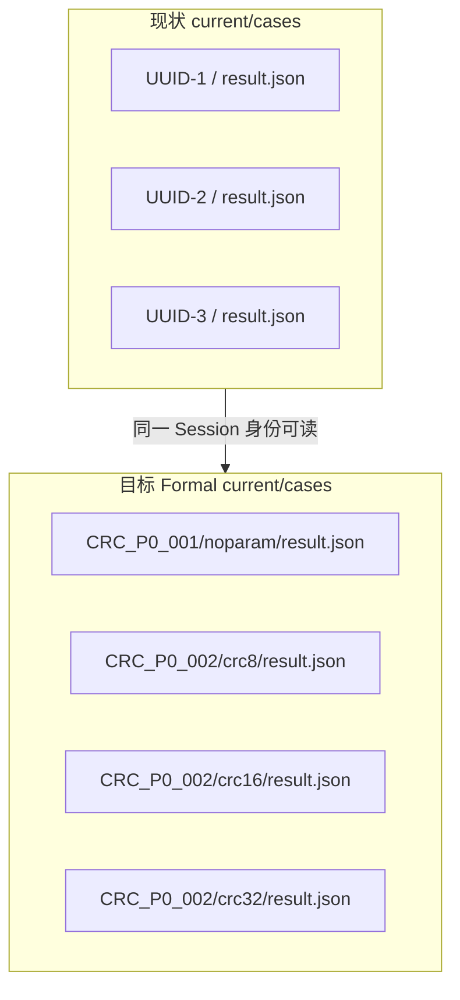
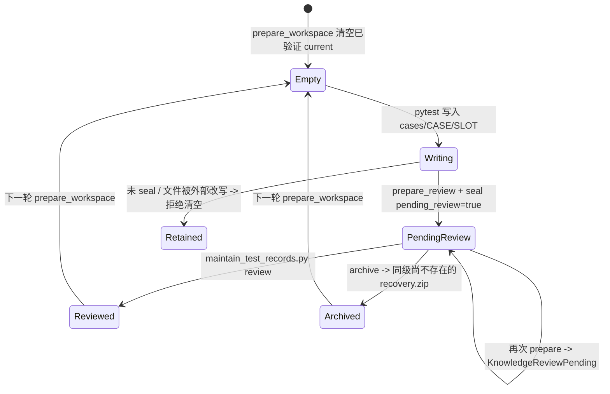

# Case Artifact 收敛目录设计

| 字段 | 值 |
|---|---|
| 文档标题 | `current/cases` 由 UUID 执行目录收敛为按 `case_id` 的固定工作副本 |
| 作者 | TBD（设计确认后由 Owner `operator_pipeline` / `canonical_result_evidence` 落地） |
| 日期 | 2026-09-10 |
| 修订 | 2026-09-10 review round 1 |
| 状态 | Draft |
| 角色 | `proposal`（不是 Rxxx 规则正文。活动规则 R130/R500/R210 只与 Writer 切换同一变更集合落地，禁止先改契约后留 UUID Writer） |
| 范围 | 设计确认；本阶段不改业务 / Runner / 测试代码 |

---

## Overview

`artifacts/records/<CHIP>/<IP>/current/cases` 今天为 **每一次 pytest execution** 分配一个 UUID 目录（`case_run_id = uuid4()`）。一次 IP Session 里目录数等于参数节点数，而不是 Case 数。以 2026-09-10 本仓库 ET6801 `current` 实测：13 个 IP 合计 **668 个 UUID 目录**，对应 **212 个 `case_id`**（SPI 152 目录 / 12 Case，CAN 148 / 31）。这些 UUID **并不保存跨轮历史**——`prepare_workspace()` 在通过 `publication.json` 复用门禁后会清空整个 `current/`。UUID 只解决 **同 Session 内执行隔离与附件撞名**。

本设计把 Formal Case 的 `current/cases/<CASE_ID>/` 变成该 Case 的 **收敛工作副本**：第一层按稳定 `case_id`；每个 execution 固定两层 `cases/<CASE_ID>/<SLOT>/`；下一轮正式运行在通过知识整理门禁后 **覆盖同路径**，不再追加 UUID。布局策略按 **注册表身份** 分支，而不是按 `--et-artifact-dir` 全局切换：无 `ip_id` 的诊断/插件单测继续 UUID 隔离。跨轮原始现场仍按 R500 只保留一份 `current/`；历史结论进 `cases/<CASE_ID>.md`，紧急原始现场进既有 `recovery.zip`。`run_id` 继续以 UUID 写在 JSON 内容里。`case_run_id` 对 Formal execution 改为稳定派生值，**不再是目录名、不再是跨 Session 主键、禁止按 `--` 拆分**。

---

## Background & Motivation

### 当前链路（已实现）

```text
run_ip_tests.py
  -> prepare_workspace(records/<CHIP>/<IP>/current)     # 整棵 current 复用/清空
  -> pytest --et-artifact-dir current
       pytest_plugin.pytest_collection_modifyitems
         RunContext.allocate_case() -> uuid4()          # 每个 item 一个 UUID
       pytest_runtest_call / makereport
         bind_case_artifact(case_run_id, path)          # 目录 = case_run_id
         write_case_result(case_run_id, payload)
  -> _validate_canonical_run(): case_run_id == 目录名     # 只服务当次 Formal current
  -> prepare_review() -> facts.md + Excel + publication.json(pending_review=true)
  -> Agent 整理 records/<CHIP>/<IP>/cases/<CASE_ID>.md
  -> maintain_test_records.py review -> 放行下一轮覆盖
```

权威契约：

- 运行目录与复用门禁：`report/design/rules/R500_operator_pipeline.md` 第 6 节
- Canonical Result：`report/design/rules/R130_canonical_result_evidence.md` 第 4、8 节
- Case 参数化：`report/design/rules/R210_pc_case_responsibility.md` 第 3 节（`parametrize`，禁止复制 Case）；第 8 节附件句目前写“按 `case_run_id` 隔离”
- 实现：`pc/et_test_platform/scheduling/run_context.py`、`pc/et_test_platform/pytest_plugin.py`、`tools/runner/record_workspace.py`、`tools/runner/maintain_test_records.py`

### 痛点（可量化）

| IP | 当前 UUID 目录（= execution 数） | Session `selected_case_ids` | 知识 Markdown | 单 Case 最大参数节点 |
|---|---:|---:|---:|---:|
| SPI | 152 | 12 | 12 | 48（`spi_p1_002`） |
| CAN | 148 | 31 | 31 | 35 |
| DMA | 88 | 28 | 28 | 27（`dma_p1_014`） |
| AES | 59 | 26 | 26 | 12 |
| CORDIC | 53 | 24 | 24 | 9 |
| FMAC | 46 | 23 | 23 | 11 |
| IPCM | 34 | 13 | 13 | 16 |
| STIMER | 27 | 16 | 16 | 5 |
| SYSCNT | 23 | 7 | 7 | 10 |
| SPINLOCK | 15 | 11 | 11 | 2 |
| WDG | 14 | 14 | 14 | 1 |
| CRC | 5 | 3 | 23 | 3（`crc_p0_002`） |
| UART | 4 | 4 | 33 | 1 |
| **合计** | **668** | **212** | — | — |

人工打开 `current/cases` 无法按 Case 浏览；`facts.md` / Excel 已经按 `case_id` 聚合，但原始目录没有同样的身份。CRC 的 `CRC_P0_002` 三个模式（`crc8`/`crc16`/`crc32`）落在三个互不相关的 UUID 下，例如：

- `cases/06bd50ed-5154-4d57-ae75-78dded033a70/` → `parameter_id=crc8`
- `cases/42cae4d4-cb58-4734-982d-583bfe62a193/` → `parameter_id=crc16`
- `cases/042f38fd-f586-48a3-89fb-091d7feedb45/` → `parameter_id=crc32`

### R500 已有的“UUID 不进目录名”原则

R500 §6.1：

> 禁止换用日期、UUID、`round_NN` 等目录累积新证据；时间和 UUID 只写入内容。

`current/` 作为 IP 工作区已经收敛（不按轮次建目录）。缺口是 **工作区内部 Formal Case 目录仍用 UUID**。本设计把这条原则下推到 Formal 的 `current/cases/`，而不是再引入一轮目录膨胀。无注册表身份的 `--et-artifact-dir` 诊断输出仍用 UUID 隔离（见布局策略）。

---

## Goals & Non-Goals

### Goals

1. Formal `current/cases/` **第一层** 目录数以本 Session 选中的 `case_id` 数为上界（ET6801 全量约 212，而不是 668）。
2. **一个 Formal Case 一个文件夹**，键为稳定 `case_id`（目录名 `CRC_P0_002`），不是 UUID。
3. **文件种类固定**：每个 execution 恰好一份 `result.json`，附件只进入可选的 `artifacts/`。Case 文件夹内的 **子目录数量跟踪该 Case 本 Session 的参数节点数**，不为了“数字好看”而压扁（见策略 A 残余与策略 D）。
4. 下一轮正式运行在复用门禁通过后 **覆盖同一 Case 路径**，不追加 UUID。
5. 参数化 Case 的每个 `(case_id, parameter_id)` 仍是独立 Canonical execution（R130 / R210 不变）。
6. 未整理现场 **不得覆盖**（保持 `KnowledgeReviewPending`）。
7. Excel / `facts.md` / `extract` 继续按 Case 聚合、按参数分行；历史 `artifacts/runs/**` 只读可解析。
8. `run_id`、逻辑 Pipeline UUID 仍只出现在 JSON 内容中。
9. 无注册表身份的插件/诊断 Canonical 输出继续可写、可测，不把 `nodeid` 塞进 `safe_name`。

### Non-Goals

- 不在本阶段改 Case 业务、断言、Driver、Firmware。
- 不把多参数 execution 合并成一份 Canonical `result.json`。
- 不恢复旧的长期 `results.json` / 每 Case ZIP / 自动档案。
- 不在 `current/` 或同级建立 `round_NN`、日期目录或无限 `archive/<run_id>/`。
- 不放宽 R500：部分执行不得把历史 PASS 合并进本次 Excel。
- 不让 Case Markdown 链接到可覆盖的 `current/`（`record_check.py` 已禁止）。
- 不把 `case_run_id` 的平台所有权交给 Case 代码，也不把它重新当作路径分量。
- 不把 `--et-artifact-dir` 下所有 item 强制改成 nested 布局。

---

## 今日为何使用 UUID（必须保留的语义）

`RunContext.allocate_case()` 明确为“每次收集到的 Case 分配独立 UUID”，目的不是跨轮归档，而是：

| 原因 | 代码位置 | 若直接改成 `cases/<case_id>/result.json` 会丢什么 |
|---|---|---|
| **同 Session 执行隔离** | `pytest_plugin.py` 对每个 item 调用 `allocate_case()` | 同一 `case_id` 的多个 `parametrize` 节点会写同一 `result.json`，后一次覆盖前一次 |
| **附件撞名隔离** | `bind_case_artifact()`；回归 `test_run_context_binds_reused_artifact_name_to_each_case_execution` | 两个参数若都 `write_json_result(run/shared.json)`，第二发会覆盖第一发已绑定文件 |
| **身份不可伪造** | R130：`RunContext` 拥有 `run_id`/`case_run_id`，调用方旧身份必须被覆盖 | Case 不能自己指定目录名来冒充另一次 execution |
| **唯一性校验** | `case_report._validate_case_results` 要求 **本 Session 内** `case_run_id` 唯一；`run_ip_tests._validate_canonical_run` 要求 `case_run_id == 目录名` | 需要新的“目录 ↔ 身份”等式；`case_run_id` 不再等于目录名 |
| **seal 无残留** | 绑定后删除 Session 根源文件，避免 `publication.json` 把残留当 extra | 路径规则变了，这条删除语义必须保留 |
| **无注册表 item** | `_case_identity` 在 `RegistryError` 时退回 `item.nodeid`（含 `/`、`::`）；`select_registered_cases` 对 `case_root` 外的路径仍 selected | `safe_name(nodeid)` 必然失败。这些 item 仍 `write_case_result` |

**结论：** UUID 是“一次 execution 一份快照”的隔离键。Formal 收敛目录把隔离键从 **第一层目录名** 挪到 **Case 目录内的稳定 slot**。无注册表输出 **继续用 UUID 当第一层目录名**。跨轮历史从来不是 UUID 提供的：`test_workspace_reuses_only_fixed_directory` 证明 `current/` 复用后为空；`test_pending_review_blocks_overwrite_even_after_pass` 证明未 `review` 时连 PASS 也不能覆盖。

---

## Proposed Design

### 布局策略：按注册表身份，不按 `--et-artifact-dir`

`pytest_plugin.pytest_collection_modifyitems` 在设置了 `--et-artifact-dir` 时对 **每个** item 分配身份，包括 `test_cases/` 以外的文件。`select_registered_cases()` 对路径不在 `case_root` 下的 item 仍放入 `selected`；`record_selection()` 因 `ip_id is None` 跳过它们，但 `write_case_result()` 仍会执行。

| 分支 | 判定 | 目录 | `case_run_id` |
|---|---|---|---|
| **Formal / 注册表** | `_case_identity(item)` 得到注册表 `case_id` 且 `ip_id is not None` | `cases/<CASE_ID>/<SLOT>/` | 稳定 `{CASE_ID}--{SLOT}` |
| **诊断 / 插件单测** | `_case_identity` 因 `RegistryError`/`AttributeError` 退回 `nodeid`，或 `ip_id is None` | `cases/<uuid>/`（与今日相同） | `uuid4()`（与今日相同） |

Formal `run_ip_tests` 在 `_validate_canonical_run` 中 **只接受 nested 注册表布局**。若某条 selected Formal execution 没有注册表 `case_id`，收集期 `pytest.UsageError`，不得降级为 UUID 后混进 `records/<CHIP>/<IP>/current`。

受影响、且今日 glob `cases/*/result.json` 的插件测试（Writer 切换后 **继续 UUID**，glob 不用改成 nested）：

- `pc/et_test_platform/framework_validation/unit/scheduling/test_run_context.py`
  - `test_pytest_plugin_writes_pass_and_skip_case_evidence`
  - `test_plugin_preserves_parameterized_artifacts_and_relative_references`
  - `test_pytest_plugin_records_setup_and_teardown_failures`
- `pc/et_test_platform/framework_validation/unit/core/test_result_integrity_gate.py`

`test_operator_launcher.py` 使用 `test_record_source.make_session` 的 **合成 Formal CRC**（JSON 里有 `crc_p1_001`，目录却是 `cases/{case_run_id}/`）。该夹具在 Writer PR 改为 nested；Reader PR 同时保留一份 legacy 样本。

直接调用 `bind_case_artifact("case-first", ...)` 的单测（`test_run_context.py` 中 `case-first` / `case-second` / `case-root` / `case-bound` / `case-1`）改为传入 `ExecutionIdentity`，`execution_dir` 仍可指向 `cases/case-first/` 这类测试夹具名；**禁止**再把 `case_run_id` 字符串当作目录分量。

### 目标身份

| 身份 | 作用域 | 形式 | 是否进目录名 |
|---|---|---|---|
| `run_id` | 一次 pytest Session | UUID，写入 `session.json` / 每份 `result.json` | 否 |
| `manifest.run_id` / `pipeline_run_id` | 一次 Operator 运行 | UUID，写入 `manifest.json` | 否 |
| `case_id` | 注册表稳定 Case | JSON 小写 `crc_p0_002`；目录 `CRC_P0_002` | Formal：**是（第一层）** |
| `parameter_id` | 一次 parametrize execution | pytest 稳定 id，或 `null`；JSON **原文保存** | Formal：**是（第二层 slot，另见大小写折叠）** |
| `case_run_id`（Formal） | **本 Session 内** execution 校验键 | 派生 `{CASE_ID}--{SLOT}` | **否。禁止当路径、禁止跨 Session 主键、禁止按 `--` 拆开** |
| `case_run_id`（无注册表） | 同上 | UUID | **是**（第一层，与今日相同） |

Formal `case_id` 来自 `pc/et_test_platform/scheduling/test_registry.py`：

```text
_CASE_ID_PATTERN = r"^(?P<ip>[a-z][a-z0-9_]*?)_p(?P<level>[0-3])_(?P<number>[0-9]{3})$"
```

命名分组 `ip` 把 Case 绑到 IP。目录名 `CASE_ID = safe_name(case_id).upper()`，与知识文件 `records/<CHIP>/<IP>/cases/CRC_P0_002.md` 对齐。JSON `case_id` 保持小写注册表形式。

### Slot 规则（Formal nested）

- 每个 Formal execution 的 Canonical Result 路径 **恰好两层**：`cases/<CASE_ID>/<SLOT>/result.json`。无参数 Case 不得省略 slot（否则 `CRC_P0_001/result.json` 与 `CRC_P0_002/crc32/result.json` 会在同一 `current/` 被判为混合布局）。
- `parameter_id is None` → 保留 slot 名 `noparam`。`noparam` 已匹配 `safe_name` 的 `[A-Za-z0-9][A-Za-z0-9_.-]{0,127}`，**不必**加入 `_PIPELINE` 那份特殊允许名单。
- 否则 slot 目录名 = `safe_name(parameter_id)` 的返回值（`safe_name` 不改写大小写）。JSON 仍保存 pytest 原文 `parameter_id`。
- 禁止静默把 `[`、空格、`0x` 改成 `_`。
- 收集期保留名冲突 → `pytest.UsageError`：真实 `parameter_id` 经 `safe_name` 后不得为 `noparam` 或 `artifacts`（后者会与附件目录以及历史 `cases/<uuid>/artifacts/result.json` 混淆）。
- **Windows 文件系统身份**：本机 Operator 是 Windows，目录大小写不敏感。仅比较 JSON 字符串会让 `crc32` 与 `CRC32`（或 `False` 与 `false`）通过 `(case_id, parameter_id)` 唯一性，然后第二个 execution 静默覆盖第一个 slot。收集期必须用

  ```text
  (case_dir_name(case_id).casefold(), execution_slot(parameter_id).casefold())
  ```

  检测碰撞。JSON 继续保存原文；目录只存在一份。实施回归：`crc32` vs `CRC32`。
- `safe_name` 已拒绝 Windows 保留设备名与长度 > 128。堆叠 parametrize 的 `callspec.id` 超 128 字符 → 收集失败，不得截断。
- 同一 Session 内 `(case_id, parameter_id)` 字符串重复已经非法；再加上上述 casefold 目录碰撞。

### `case_run_id` 字段语义（Formal）

今日：`case_run_id` 是每 execution 的 UUID，**并且就是目录名**。下列消费者按路径耦合：

| 消费者 | 今日耦合 | 切换后 |
|---|---|---|
| `RunContext.bind_case_artifact` / `write_case_result` | `cases / case_run_id / ...` | 只用 `ExecutionIdentity.execution_dir`；**禁止**读 `case_run_id` 拼路径 |
| `run_ip_tests._validate_canonical_run` | `result["case_run_id"] == parent.name` | nested 等式（见 Impact §4）；**只接受 nested，不双布局** |
| `record_source._selected_results` | 同上 | 按路径形状分类；legacy 仍用旧等式 |
| `maintain_test_records._source_files` | `cases/{case_run_id}/result.json` | **seal 会炸的消费者**：必须改为实际相对路径。若仍用 `case_run_id` 当目录，Writer 已 nested 时会去 hash `cases/CRC_P0_002--crc32/result.json`（策略 B 幽灵路径），`expected_files` 与磁盘不一致 → `unbound or modified files remain` |
| `case_report._validate_case_results` | 仅 Session 内唯一，不比路径 | 保持 Session 内唯一；不把稳定值当全局 PK |
| Excel / `facts.md` | 不按 `case_run_id` 做键（Excel 用 `_result_path`） | 不变 |

约束：

1. Formal `case_run_id` 是 `(CASE_ID, SLOT)` 的派生校验字符串，**仅在本 Session 内**唯一（与 R130 §7 现状一致）。跨 Session 同一 Case 再跑会得到 **同一个** `CRC_P0_002--crc32`，不得当全局主键。
2. **禁止** `case_run_id.split("--")` 还原身份：`safe_name` 允许连字符，`parameter_id` 可以含 `--`。还原只用 JSON 的 `case_id` + `parameter_id`。
3. `schema_version` 保持 `1`。今日没有任何消费者对 `case_run_id` 做 UUID 格式检查（已核对）。Reader 也 **禁止** 新增 UUID 格式断言。
4. 契约 PR（与 Writer 同集）把 R210 中“Canonical Result会按`case_run_id`隔离”改为按 **slot 目录**（`cases/<CASE_ID>/<SLOT>/`）隔离同名附件。

### 目标目录树（Before / After）

**Before（现状，CRC 2026-09-10 `current`，3 Case / 5 execution）：**

```text
artifacts/records/ET6801/CRC/
├─ README.md
├─ cases/CRC_P0_001.md          # 长期知识，不在本次改动范围
├─ current/
│  ├─ manifest.json             # run_id UUID 在内容里
│  ├─ session.json
│  ├─ pytest.log
│  ├─ facts.md
│  ├─ specification.md
│  ├─ publication.json          # pending_review=true 时不可覆盖
│  ├─ config/run_config.snapshot.yaml
│  └─ cases/
│     ├─ 935a2dff-.../result.json + artifacts/crc_p0_001_runtime_capabilities.json
│     ├─ 06bd50ed-.../result.json + artifacts/crc_p0_002_crc8.json
│     ├─ 42cae4d4-.../result.json + artifacts/crc_p0_002_crc16.json
│     ├─ 042f38fd-.../result.json + artifacts/crc_p0_002_crc32.json
│     └─ 5ee5917c-.../result.json + artifacts/crc_p0_003_lifecycle_recovery.json
└─ _maintenance/
└─ recovery.zip                 # CRC 已占用；不可再 archive 绕过 review
```

**After（同一 Formal Session）：**

```text
artifacts/records/ET6801/CRC/
├─ README.md
├─ cases/CRC_P0_001.md
├─ current/
│  ├─ manifest.json
│  ├─ session.json
│  ├─ pytest.log
│  ├─ facts.md
│  ├─ specification.md
│  ├─ publication.json
│  ├─ config/run_config.snapshot.yaml
│  └─ cases/
│     ├─ CRC_P0_001/noparam/result.json
│     ├─ CRC_P0_001/noparam/artifacts/crc_p0_001_runtime_capabilities.json
│     ├─ CRC_P0_002/crc8/result.json
│     ├─ CRC_P0_002/crc8/artifacts/crc_p0_002_crc8.json
│     ├─ CRC_P0_002/crc16/...
│     ├─ CRC_P0_002/crc32/...
│     └─ CRC_P0_003/noparam/...
└─ _maintenance/
```

`current/` 根文件种类不变。Excel 仍只发布到 `artifacts/reports/<CHIP>/<CHIP>_<IP>测试报告.xlsx`（`prepare_review` 对 `test_report.xlsx` 写 `None`）。

SPI 全量第一层 152→12；`SPI_P1_002` 内部最多 48 个稳定 slot，下一轮覆盖同名 slot。第一层减少的同时，**总目录节点数会上升**（约 212 个 Case 目录 + 668 个 slot，对比今日 668 个 UUID 目录）。用户要的是按 Case 可管理，不是最小化 inode。



---

## 参数化：策略与推荐

同一 `case_id`、多组参数是本设计最难点。当前模型已经是 **一个 pytest item = 一次 execution = 一份 `result.json`**，键为 `(case_id, parameter_id)`。

### 策略 A（推荐）：Case 目录 + 稳定 parameter slot

```text
current/cases/<CASE_ID>/<SLOT>/result.json
current/cases/<CASE_ID>/<SLOT>/artifacts/...
```

- 第一层目录数 = 选中 Case 数。
- 每个 execution 仍是独立 Canonical Result；附件隔离保留。
- **种类** 在 slot 级固定（`result.json` ± `artifacts/`）。
- **残余（对用户“文件夹内文件数量尽量固定”）**：Case 文件夹的子目录数 = 本 Session 该 Case 实际 execution 数（`SPI_P1_002` → 48）。不把参数矩阵压扁。矩阵变了，数量才变；同一次 Registry/代码状态下重复跑，数量稳定并可被覆盖。
- 读取用路径形状分类，**不要** 用裸 `cases/*/*/result.json`（会把 `cases/<uuid>/artifacts/result.json` 误判为 nested）。

代价：多一层目录；无参数 Case 固定占 `noparam`。

### 策略 B：`cases/<CASE_ID>--<SLOT>/` 扁平 execution 目录

违反“一个 Case 一个文件夹”；SPI 第一层仍是 152。且与稳定 `case_run_id` 字符串相同，极易让 `_source_files` 写错路径。否决为目标；实施时用类型系统禁止把 `case_run_id` 当目录。

### 策略 C：一份聚合 `result.json` 内含 `executions[]`

破坏 R130 单 execution、Excel 去重、中途 Snapshot、附件隔离。否决。

### 策略 D（为“Case 内文件数固定”补齐后否决）：slot 文件而不是 slot 目录

```text
current/cases/<CASE_ID>/<SLOT>.json
current/cases/<CASE_ID>/artifacts/<SLOT>/...
```

- 第一层仍是一个 Case 文件夹；Case 根下是 N 个 json + 一个 `artifacts/`。
- 仍要按 SLOT 隔离附件，只是把 `result.json` 从 execution 目录里拆走。
- 破坏今日 bind/seal 的执行单元“一个目录里 `result.json` + 可选 `artifacts/`”。
- glob `cases/*/*.json` 会与其它 json 混淆；`CRC_P0_002/crc32.json` 与 `CRC_P0_002/artifacts/crc32/` 种类在 Case 根混杂，**并不比 A 更固定**。
- 否决。保留 A 的“每种 execution 一个小目录”。

### 推荐

**策略 A。** 参数节点数是 R210 parametrize 的固有维度。

---

## 每 Case 文件夹的固定文件清单

平台保证的种类（Formal nested，不多也不少）：

| 路径 | 何时存在 | 数量 |
|---|---|---|
| `cases/<CASE_ID>/<SLOT>/result.json` | 每个实际执行的 `(case_id, parameter_id)` 恰好一份 | = 本 Session 该 Case 的 execution 数 |
| `cases/<CASE_ID>/<SLOT>/artifacts/` | 仅当 `bind_case_artifact` 至少绑定一个文件 | 0 或 1 个目录 / slot |
| `cases/<CASE_ID>/<SLOT>/artifacts/<name>` | Case 经公共 recorder 显式登记的附件 | Case 自定义；平台不扫描、不生成索引 |

**不创建：** `index.json` / `executions.json`；空 `artifacts/`；未执行参数的占位 `result.json`；第二份 `session.json`。

`result.json` 字段集合保持 R130 第 4 节。Formal 变化：

1. `case_run_id` 从 UUID 变为 `{CASE_ID}--{SLOT}`（语义见上，不是“布局-only”）。
2. `artifacts` 里的 run-relative 路径变为 `cases/<CASE_ID>/<SLOT>/artifacts/...`。

目标示例：

```text
"case_run_id": "CRC_P0_002--crc32"
"artifacts": {
  "measurement_artifact_result": "cases/CRC_P0_002/crc32/artifacts/crc_p0_002_crc32.json"
}
```

附件文件名仍由 Case/`write_json_result` 决定。种类稳定性来自“永远是 result.json ± artifacts/”。

---

## 覆盖规则、Publication / Review / Archive

覆盖对象仍是 **整棵 `current/`**。Case 路径收敛之后，“覆盖那个 Case 目录”是整棵清空后的 **同名重建**。



`prepare_workspace()` 清空条件与今日相同（回执、Hash、`pending_review`、Pipeline 兄弟 IP、完好 `archive` 证明）。**未整理不能覆盖**，门禁是工作区级。只复测一个 Case 的下一轮，review 之后 `current/` 只含该 Case；不把历史 PASS 留在未选中目录里。

R500 archive 不是轮次库：目标必须是 **尚不存在** 的同级 `recovery.zip`。CRC **已经有** `recovery.zip`，不能靠 archive 绕过 `pending_review`，只能 `review`。

复核链不变：pending 时读 nested 路径；review 后读 Markdown + Excel；覆盖后原始字节默认不保留，除非事先 archive 或读只读 `artifacts/runs/**`。默认不加 `previous.zip` / `archive/<run_id>/`。

---

## Impact Surface

### 1. `ExecutionIdentity` 与 Writer API

文件：`pc/et_test_platform/scheduling/run_context.py`、`pc/et_test_platform/pytest_plugin.py`

```python
from dataclasses import dataclass
from typing import Literal

DEFAULT_SLOT = "noparam"
RESERVED_SLOTS = frozenset({DEFAULT_SLOT, "artifacts"})

@dataclass(frozen=True, slots=True)
class ExecutionIdentity:
    layout: Literal["nested", "uuid"]
    case_id: str | None          # 注册表小写；uuid 布局为 None
    ip_id: str | None
    parameter_id: str | None     # JSON 原文
    slot: str | None             # nested 才有
    case_run_id: str             # nested: CASE--SLOT；uuid: uuid4()
    execution_dir: Path          # artifact_dir 下的绝对目录，含 result.json 的父目录
```

纯函数：

```python
def case_dir_name(case_id: str) -> str:
    return safe_name(case_id).upper()

def execution_slot(parameter_id: str | None) -> str:
    if parameter_id is None:
        return DEFAULT_SLOT
    name = safe_name(parameter_id)  # 原样大小写；非法字符/保留设备名/超长失败
    if name.casefold() in {item.casefold() for item in RESERVED_SLOTS}:
        raise ValueError(f"parameter_id {parameter_id!r} collides with a reserved slot")
    return name

def filesystem_execution_key(case_id: str, parameter_id: str | None) -> tuple[str, str]:
    return case_dir_name(case_id).casefold(), execution_slot(parameter_id).casefold()

def stable_case_run_id(case_id: str, parameter_id: str | None) -> str:
    return f"{case_dir_name(case_id)}--{execution_slot(parameter_id)}"

def execution_dir(artifact_dir: Path, case_id: str, parameter_id: str | None) -> Path:
    return artifact_dir / "cases" / case_dir_name(case_id) / execution_slot(parameter_id)
```

`RunContext.allocate_execution(item) -> ExecutionIdentity`：

- 注册表身份 → `layout="nested"`，收集期登记 `filesystem_execution_key`；重复 key → `UsageError`。
- 否则 → `layout="uuid"`，`case_run_id = uuid4()`，`execution_dir = artifact_dir / "cases" / case_run_id`（单层）。
- **删除** 对外的“返回路径分量字符串”的 `allocate_case()`。UUID 分配只作为 `layout="uuid"` 的内部步骤，避免调用方把返回值送进 `bind_case_artifact` 当目录。

`bind_case_artifact(self, identity: ExecutionIdentity, artifact_path) -> str`：

- `destination_root = identity.execution_dir / "artifacts"`。
- **禁止** 使用 `identity.case_run_id` 拼路径（稳定值 `CRC_P0_002--crc32` 仍满足今日的 `Path(x).name == x`，会悄悄变成策略 B）。
- 三条绑定语义保持，相对路径随 `execution_dir` 更新：
  1. Session 根源文件：复制到 `destination_root / source_relative` 后 `unlink` 源。
  2. 源已在本 `destination_root` 下：不删除，返回现有相对路径。
  3. 再绑定已消费的 Session 根源路径：按 `destination_root / source_relative` 命中已有副本（不再用 `cases/<case_run_id>/artifacts` 推算）。

`write_case_result(self, identity: ExecutionIdentity, result)` 写 `identity.execution_dir / "result.json"`，并覆盖 `payload["case_run_id"] = identity.case_run_id`。

`pytest_plugin` stash 只存 `ExecutionIdentity`。`bind` / `write` 从 stash 取对象。

收集期 Formal 门禁（Writer PR，在 HIL 之前）：对 `IP_REGISTRY` 做一次无硬件 collect，断言每个 selected Formal item 的 `callspec.id`（无 parametrize 则为 `None` → `noparam`）能通过 `execution_slot`，且 `filesystem_execution_key` 无碰撞。不要等现场 Session 才发现 `[...]`、空格、超长堆叠 id。

### 2. `prepare_workspace` / `seal` / `review` / `archive`

**行为不变。** 整棵 `current/`，不解析 Case 目录名。`publication.json` 的键随实际相对路径变化。schema 仍 `et.run-workspace.v3`。

### 3. `prepare_review` / Excel / facts / 历史 extract

| 组件 | 今日依赖 | 变化 | 双布局？ |
|---|---|---|---|
| `maintain_test_records._source_files` | `cases/{case_run_id}/result.json` | 用加载到的实际相对路径；**seal-breaking** | 是（路径形状） |
| `record_source._selected_results` | `*/result.json` + `case_run_id == parent.name` | `iter_canonical_results` | 是 |
| `record_report.render_facts` | 按 Case 聚合 | 不变 | 跟随 source |
| `results/case_report._load_case_results` | `cases/*/result.json` | `iter_canonical_results` | 是（历史 Run + 新 current） |
| `generate_case_report.py` | 调用 model | 无独立 glob | 跟随 case_report |
| `run_ip_tests._validate_canonical_run` | `case_run_id == parent.name` | Writer 之后 **只接受 nested**。不是历史 Reader，禁止双布局，以免 UUID Writer bug 过 Formal 门禁 | **否** |
| 知识树 `record_store` / `record_check` | `cases/<CASE_ID>.md` | 不变 | — |

### 4. Formal 当次校验等式（nested-only）

```text
result_path == <current>/cases/<CASE_ID>/<SLOT>/result.json
CASE_ID == case_dir_name(result["case_id"])
SLOT == execution_slot(result["parameter_id"])
SLOT.casefold() != "artifacts"
result["case_run_id"] == stable_case_run_id(case_id, parameter_id)
result["run_id"] == session["run_id"]
(case_id, parameter_id) 在 Session 内唯一且 ⊆ selected_executions
filesystem_execution_key 在 Session 内唯一
```

禁止把 UUID 形状的第一层目录当作 **新** Formal `current` 输出。

---

## Data Model Changes

不增加 Canonical 字段，不改 `schema_version`（仍为 1）。`case_run_id` 对 Formal 是 **字段语义变化**（UUID → 稳定派生值），不是“只改路径”。跨 Session 碰撞是预期的；唯一性范围仍是单 Session。

| 字段 | 今日 | Formal 目标 |
|---|---|---|
| `session.run_id` | UUID | 不变 |
| `result.case_run_id` | UUID = 目录名 | `{CASE_ID}--{SLOT}`，不是目录名 |
| `result.case_id` | 小写注册表 id | 不变 |
| `result.parameter_id` | 字符串或 `null` | 不变（原文；目录 slot 另做 casefold 唯一） |
| `result.artifacts.*` | `cases/<uuid>/...` | `cases/<CASE_ID>/<SLOT>/...` |
| `publication.schema` | `et.run-workspace.v3` | 不变 |

---

## Migration

禁止在未 `review`/`archive` 时把 UUID 目录改名为 `CASE_ID`（破坏 `publication.json` Hash）。

### 读取器：按路径形状分类（禁止裸两层 glob）

今日合法 legacy 树可以有 `cases/<uuid>/artifacts/result.json`（`bind_case_artifact` 可复制任意 run-relative 文件）。裸

```python
nested = cases_root.glob("*/*/result.json")
flat = cases_root.glob("*/result.json")
if nested and flat: raise Mixed
```

会把这份附件当成 nested Canonical Result，对历史 `artifacts/runs/**/tests/<ip>/cases/<uuid>/` **误报混合布局**。

正确分类：

```python
def classify_canonical_result(path: Path, cases_root: Path) -> str | None:
    rel = path.relative_to(cases_root)
    parts = rel.parts
    if "artifacts" in parts:
        return None  # 绑定附件，包括 artifacts/result.json；不是 Canonical Result
    if parts[-1] != "result.json":
        return None
    if len(parts) == 2:
        return "legacy"   # cases/<id>/result.json
    if len(parts) == 3 and parts[1] != "artifacts":
        return "nested"   # cases/<CASE>/<SLOT>/result.json
    return "unknown"

def iter_canonical_results(cases_root: Path) -> tuple[str, list[Path]]:
    legacy, nested, unknown = [], [], []
    for path in sorted(cases_root.glob("**/result.json")):
        kind = classify_canonical_result(path, cases_root)
        if kind == "legacy":
            legacy.append(path)
        elif kind == "nested":
            nested.append(path)
        elif kind == "unknown":
            unknown.append(path)
    if unknown:
        raise ValueError(f"unsupported result.json placement: {unknown!r}")
    if legacy and nested:
        raise ValueError("mixed canonical case layouts; preserve the workspace")
    if nested:
        return "nested", nested
    return "legacy", legacy
```

- `legacy`：`case_run_id == parent.name`（历史 Run、切换前 `current`、无注册表插件输出）。
- `nested`：Formal 新等式；`parent.name == execution_slot(parameter_id)`（大小写：目录名来自 `safe_name` 原文，JSON `parameter_id` 原文与 slot 字符串相等；casefold 只用于碰撞检测）。
- 两者同时作为 Canonical Result 存在 → 失败关闭。
- 回归：种植 `cases/<uuid>/result.json` **加上** `cases/<uuid>/artifacts/result.json`，必须判为 **legacy** 且加载成功。

`run_ip_tests._validate_canonical_run` **不使用** 该双布局函数。

### 预切换清单（Writer 合并前必须做完）

2026-09-10 ET6801 实测：

| IP | `publication.pending_review` | 已有 `recovery.zip` | Writer 部署前动作 |
|---|---|---|---|
| AES | `false` | 无 | 已整理，可被 `prepare_workspace` 清空 |
| CAN | `true` | 无 | **必须 `review`**（或 `archive`，因 zip 尚不存在） |
| CORDIC | `true` | 无 | 同上 |
| CRC | `true` | **有** | **只能 `review`**；`archive` 会因已有 zip 失败 |
| DMA / FMAC / IPCM / SPI / SPINLOCK / STIMER / SYSCNT / UART / WDG | `true` | 无 | 同 CAN |

**禁止“先部署 Writer 再整理”。** 未整理时第一次 Formal 跑会在 `prepare_workspace` 被 `KnowledgeReviewPending` 挡住，现场仍是 UUID 树。若此时 Formal 校验已切 nested-only，即使有人绕过清空，当次 UUID 输出也会被拒。正确顺序：Reader 双布局已上线 → 上表 12 个 pending IP 完成 review（CRC 无 archive 捷径）→ 再合并 Writer。

`artifacts/runs/**` 不迁移。容量 256 MiB 不变。

---

## Alternatives Considered

1. **策略 B** 扁平 `CASE_ID--SLOT`：第一层仍=execution 数；与 `case_run_id` 字符串撞车。否决。
2. **策略 C** 聚合 JSON：破 R130。否决。
3. **策略 D** `SLOT.json` + `artifacts/<SLOT>/`：仍要 slot 隔离；拆掉 execution 目录。否决。
4. UUID + `by-case` 链接：`safe_path` 禁 junction。否决。
5. 只覆盖选中 Case、保留未选中旧 Result：合并历史 PASS。否决。
6. 自动 `archive/<run_id>/`：R500 禁轮次累积。否决。默认也不做 `previous.zip`。

---

## Security & Privacy Considerations

- `parameter_id` 当不可信路径分量：`safe_name` 失败关闭；禁止 sanitizing。
- Windows 上再加 **casefold 目录身份** 碰撞检测，避免 `crc32`/`CRC32` 静默覆盖。
- 保留 slot `noparam`、`artifacts`。
- `bind_case_artifact` 仍拒绝 Run 外文件。
- Credential 不进 Canonical JSON。覆盖门禁不变。
- `recovery.zip` 仍明文；不自动再复制一份。

| 风险 | 严重度 | 缓解 |
|---|---|---|
| 路径穿越 | 高 | `safe_name` / `safe_path` |
| 静默 sanitizing 导致 slot 覆盖 | 高 | 禁止 sanitizing |
| Windows 大小写不同、目录相同 | 高 | `filesystem_execution_key`；`crc32` vs `CRC32` 回归 |
| `case_run_id` 被当成策略 B 目录 | 高 | `ExecutionIdentity`；bind/write 禁用该字段拼路径；`_source_files` 用实际相对路径 |
| 裸 `*/*/result.json` 把附件当 Result | 高 | `classify_canonical_result` 忽略 `artifacts/` |
| 未 review 覆盖 | 高 | `KnowledgeReviewPending` |
| 知识链到 `current/` | 中 | `record_check` 已禁 |

---

## Observability

- `facts.md` 路径变为 `CRC_P0_002`。
- Formal 校验失败信息打印 `expected path cases/{CASE}/{SLOT}/result.json`。
- 人工核对：第一层目录数 ≈ `len(selected_case_ids)`（仅 Formal current）。
- 未整理则下一轮非零退出。不新增 metrics。

---

## Rollout Plan

1. **设计确认**（本提案保持 `proposal`/`draft`）。**不改** 活动 R130/R500。
2. 路径纯函数 + 单测（含 Windows casefold、保留名）。生产 Writer 仍 UUID。
3. **只上双布局 Reader**（`record_source` / `case_report` / `_source_files`）。此 PR **随 Writer 回滚时不得一起回退**。
4. **执行预切换清单**（12 个 pending IP `review`；CRC 不能 archive）。
5. **Writer + nested-only `_validate_canonical_run` + R130/R500/R210/`artifacts/README.md` 同一 PR**。无注册表插件测试保持 UUID。无 feature flag。
6. **回滚剧本（Writer PR）：**
   - 回退 Writer 后，生产又写 UUID。双布局 Reader **留在树上**，才能继续 `extract`/`review` 已经 seal 的 nested `pending_review` 树（否则旧 `*/result.json` 读到 0 个 Result，回执无法放行）。
   - 若某 IP nested 树需要人工保全：仅当同级 **没有** `recovery.zip` 时才 `archive`；CRC 已有 zip，禁止覆盖/换名，只能保持 Reader、完成 `review`。
   - “回退 Writer 即可” **不成立**，除非 Reader 仍在。

---

## Risks and Anti-Patterns

**应做：** Formal 按 `case_id`+slot 收敛；无注册表保持 UUID；整棵 `current` 在 review 后覆盖；历史 Run 按路径形状双读；Formal 当次校验只认 nested。

**不应做：**

1. 在 Formal `current/cases` 继续 `uuid4()`。
2. 建 `round_NN` / 每轮 archive 目录。
3. 聚合多参数为一份 `result.json`，或策略 D 把 `result.json` 拆出 execution 目录。
4. 未 `review` 覆盖；或只覆盖单个 Case 而留下历史 PASS。
5. Writer 与 Reader 写两套目录（混合 Canonical Result）。
6. 用 `case_run_id` 拼路径或 `split("--")`。
7. `_validate_canonical_run` 双布局（放行 UUID Writer bug）。
8. 裸 `glob("*/*/result.json")` 当布局探测器。
9. 先改活动 R130/R500、后留 UUID Writer。
10. 把 `nodeid` 送进 `safe_name` 当 Formal 目录。
11. 知识 Markdown 引用 `current/`。
12. 静默 sanitizing / 忽略 Windows 大小写碰撞。
13. 向 `artifacts/runs/` 写新证据；把 Excel 拷进 `current/`。
14. 改 Case 参数矩阵来“减少目录”。
15. Writer 部署前把“先跑再 review”当成合法路径。

| 风险 | 严重度 | 缓解 |
|---|---|---|
| glob 漏改导致 Excel 空读 | 高 | Reader 先于 Writer；专项回归 |
| 回退 Writer 后 nested pending 不可 review | 高 | Reader 不随 Writer 回退 |
| 历史 Run 因 `artifacts/result.json` 误报混合 | 高 | 分类函数 + 回归 |
| `_source_files` 仍用 `case_run_id` 当路径 | 高 | Reader PR 改为实际相对路径 |
| 无注册表插件测试被 `safe_name` 打死 | 高 | 布局按注册表身份分支 |
| 12 个 pending IP + CRC 已有 zip | 中 | 预切换清单；CRC 只能 review |
| SPI 48 slot 仍多 | 低 | 接受矩阵残余；不用 C/D 掩盖 |

---

## 收敛后 evidence 如何仍可复核

1. **当次 Formal Session：** `current/cases/CRC_P0_002/crc32/result.json` 含 `parameter_id`、`run_id`、Observation。
2. **覆盖前：** `pending_review` 冻结；多 IP 互锁。
3. **覆盖后结论：** `cases/<CASE_ID>.md`。
4. **覆盖后原始字节：** 仅 `recovery.zip`（若当时可建）或只读 `artifacts/runs/**`。UUID 目录从未承担跨轮历史。
5. **Excel：** 最新一份在 `artifacts/reports/<CHIP>/`。

---

## Open Questions

只列出需要 dispatcher / 用户拍板的项。

1. **是否在成功 `review` 后的下一次 `prepare_workspace` 前，自动原子替换单槽 `previous.zip`？**  
   推荐默认：**否**。

2. **Case 目录大小写？**  
   推荐默认：**大写** `CRC_P0_002`。JSON `case_id` 仍小写。Windows 下 `case_dir_name` 已 `.upper()`，Case 层不再有大小写对；slot 层仍要 casefold 碰撞检测。

3. **无参数保留 slot 的名字是否用 `noparam`？**  
   推荐默认：`noparam`。备选 `default` 更易与真实 pytest id 撞车。  
   **不是**开放问题：无参数 Case 是否省略第二层——必须写 `noparam`，见 Key Decision“两层路径”。

确认前本文件保持 `proposal` / `draft`。确认后 **不要**单独改活动规则；规则与 Writer 同 PR。

---

## References

- `report/design/rules/R500_operator_pipeline.md` §6
- `report/design/rules/R130_canonical_result_evidence.md` §1（只固化已实现行为）、§7（Session 内 `case_run_id` 唯一）、§8、§9（规则与最小代码同一变更）
- `report/design/rules/R210_pc_case_responsibility.md` §3；附件隔离句（契约与 Writer 同改）
- `report/design/rules/R001_agent_rule_governance.md`（Proposal 不得冒充活动契约）
- `pc/et_test_platform/scheduling/test_registry.py`（`_CASE_ID_PATTERN`、`select_registered_cases`）
- `artifacts/README.md`、`tools/README.md`
- `report/plans/20260908_case_knowledge_contribution_plan.md`
- `project-governance/modules/operator-pipeline.yaml`
- 实现与回归路径同上一版；插件 glob 清单见“布局策略”

---

## Key Decisions

1. **Formal `current/cases` 第一层只按大写 `case_id` 命名。** 落实 R500“UUID 只写入内容”。

2. **参数化用策略 A：`<CASE_ID>/<SLOT>/`。** 每 execution 一份 `result.json`。接受 Case 内子目录数 = 参数节点；否决 B/C/D。

3. **每个 Formal execution 恰好两层路径；无参数用保留 slot。** 禁止省略 slot，以免与 nested 探测器的混合布局规则冲突。保留 **名** 见 Open Question 3。

4. **`case_run_id`（Formal）是 `(CASE_ID, SLOT)` 的 Session 内派生校验值，不是目录名、不是跨 run 主键、禁止 `split("--")`。** `_source_files` 必须用磁盘相对路径。`run_id` 仍为 UUID。`schema_version` 保持 1。

5. **布局按注册表身份分支，不按 `--et-artifact-dir`。** 有 `ip_id`+注册表 `case_id` → nested；否则 UUID 单层。Formal current 不得混入 UUID Case 目录。

6. **覆盖整棵 `current/`，工作区级 `pending_review`。** 未整理不可覆盖。

7. **不自动累积历史轮次。** 跨轮原始包继续人工 `recovery.zip`（且不得覆盖已有 zip）。

8. **历史/extract Reader 双布局（按路径形状，忽略 `artifacts/result.json`）。Formal `_validate_canonical_run` 在 Writer 之后 nested-only。** 禁止用双布局放行当次 UUID 输出。

9. **`parameter_id` 必须通过 `safe_name`，禁止 sanitizing；收集期按 Windows casefold 检测目录碰撞。** 另保留 `artifacts` slot 名。Writer PR 含 Formal collect 干跑。

10. **Writer API 使用冻结 `ExecutionIdentity`；`bind_case_artifact` / `write_case_result` 禁止用 `case_run_id` 当路径分量。** 删除对外 `allocate_case()` 字符串接口。

11. **本阶段只出设计。活动规则正文不得在 Writer 之前单独合并。** R130 §1/§9 要求契约与已证明行为一致。

---

## PR Plan

本阶段不实施。顺序必须可独立评审，并且 **回滚 Writer 时不拆掉 Reader**。

### PR 1 — 冻结提案（不改活动规则）

- **标题：** `docs: freeze convergent current/cases proposal`
- **影响文件：** 本文件（确认后的 Open Questions 记录）；`report/design/rule_owner_catalog.yaml` 已是 `proposal`/`draft`
- **依赖：** 用户确认 Open Questions
- **说明：** **禁止** 修改 `R130`/`R500`/`R210`/`artifacts/README.md` 的规范性句子。先改活动规则会让内核描述尚未存在的 Writer。

### PR 2 — 路径纯函数（生产仍 UUID）

- **标题：** `test: add nested case artifact path helpers`
- **影响文件：** `run_context.py` 新增函数与 `ExecutionIdentity` 类型（pytest_plugin 暂不调用）；`test_run_context.py`：合法 id、`noparam`、保留 `artifacts`、非法字符、超长、`crc32` vs `CRC32` casefold 碰撞
- **依赖：** PR 1
- **说明：** Formal 运行仍走现有 `allocate_case()` UUID，直到 PR 4。

### PR 3 — 双布局 Reader only（随 Writer 回滚时保留）

- **标题：** `feat: classify legacy and nested canonical result layouts`
- **影响文件：** `record_source.py`（`iter_canonical_results` / 分类）；`results/case_report.py`；`maintain_test_records._source_files`（**改为实际相对路径，停止 `cases/{case_run_id}/result.json`**）；`test_record_source.py`、`test_case_report.py`：legacy 样本含 `cases/<uuid>/artifacts/result.json` 仍当 legacy；另加 nested 样本
- **依赖：** PR 2（可复用 `execution_slot` 校验 nested 样本）
- **说明：** 不改 `pytest_plugin`、不改 `run_ip_tests._validate_canonical_run`（当次 Formal 仍 UUID）。此 PR 使历史 `artifacts/runs` 与切换后 nested `current` 都能 `extract`/出 Excel。回滚 Writer 时 **禁止 revert 本 PR**。

### PR 4 — 预切换操作说明（文档，Writer 之前执行）

- **标题：** `docs: pre-cutover review checklist for nested case dirs`
- **影响文件：** 本提案附录或 `artifacts/README.md` 的操作段（导航，不改 R500 语义）
- **依赖：** PR 3
- **说明：** 列出 13 个 IP 的 `pending_review` / `recovery.zip`。明确 CRC 只能 review。**合并 PR 5 之前必须完成清单**，禁止“先部署 Writer 再整理”。

### PR 5 — Writer + nested-only Formal 校验 + 活动契约

- **标题：** `feat: write registry case results under cases/<CASE_ID>/<SLOT>`
- **影响文件：**
  - Writer：`pytest_plugin.py`、`RunContext.allocate_execution` / `bind_case_artifact` / `write_case_result`；删除对外 `allocate_case()`
  - Formal 当次：`run_ip_tests._validate_canonical_run` **nested-only**
  - 契约（同一变更集合）：`R130` §8 存储句与 `case_run_id` 派生语义；`R500` §6 Formal `current/cases/<CASE_ID>/<SLOT>/`；`R210` 附件隔离改为 slot 目录；`artifacts/README.md` 示例
  - 回归：`test_run_context.py` 绑定路径与 `ExecutionIdentity`；`test_operator_launcher.py` / `make_session` Formal 夹具改 nested；插件三项 + `test_result_integrity_gate.py` **保持 UUID glob**；Formal collect 干跑（每个 `callspec.id` 过 `execution_slot`）
- **依赖：** PR 3 已部署；PR 4 清单已执行
- **说明：** 唯一改变 Formal `current/cases` 实树的 PR。无注册表 item 仍 UUID。回滚本 PR 时留下 PR 3，以便 review 已 seal 的 nested 树。

每个 PR 合并后跑对应专项回归，提交前 `python tools/validate_pc.py`。不在这些 PR 中修改 Formal Case 断言、Firmware 或 Excel 版式。
