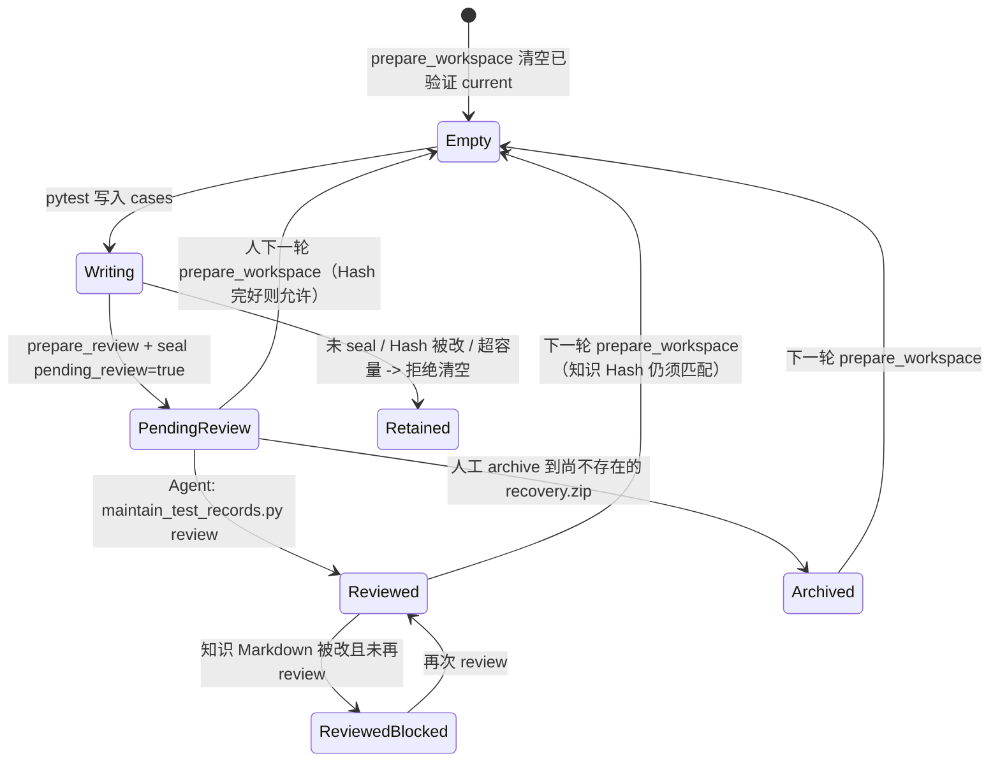
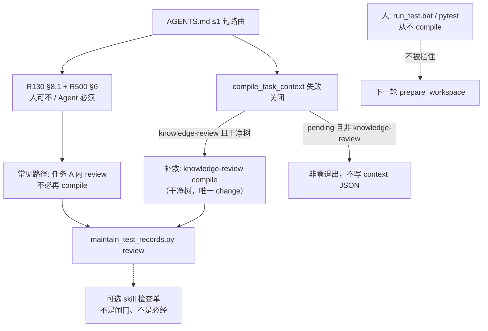
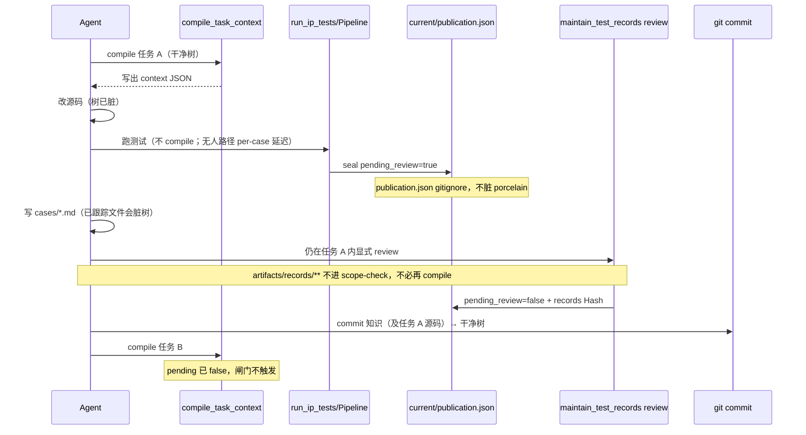
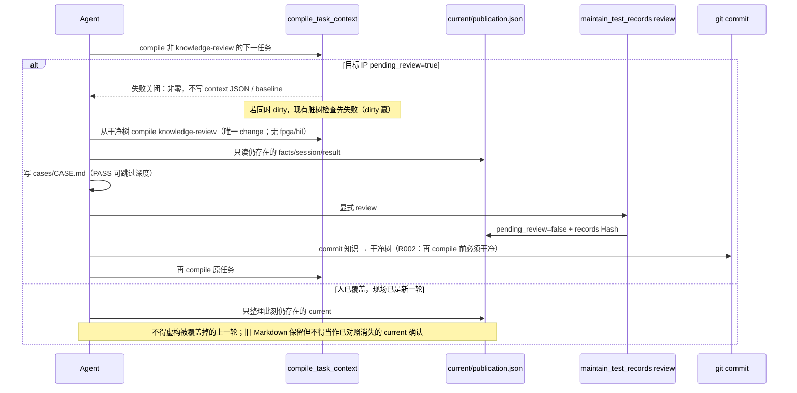
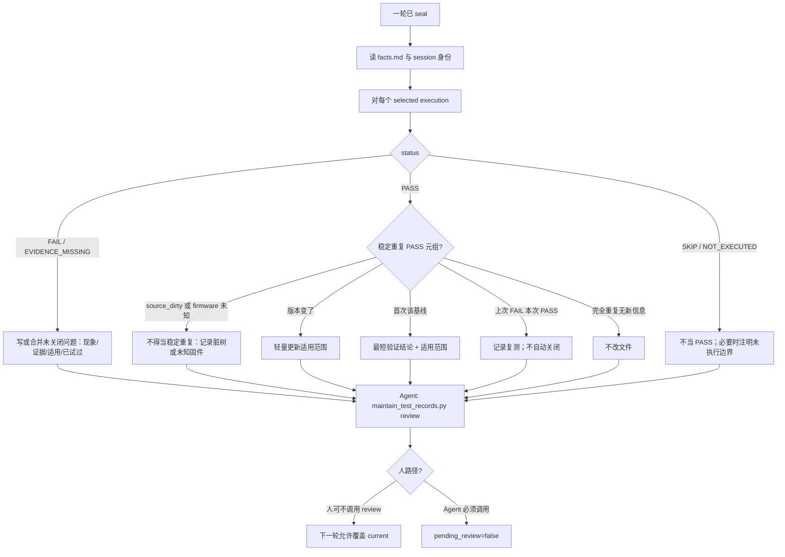

# 人可覆盖、Agent 强制 review 的一轮知识策略

| 字段 | 值 |
|---|---|
| 文档标题 | 人可覆盖、Agent 强制 review 的一轮知识策略 |
| 作者 | TBD（Owner 落地时：`operator_pipeline` + `canonical_result_evidence` + `agent_rule_governance` / `task_context_navigation`） |
| 日期 | 2026-09-10 |
| 状态 | Draft（策略默认已确认；实施仍等用户明确说动手再改 Runner） |
| 角色 | `proposal` / `lifecycle: draft`（不是 Rxxx 规则正文，不得冒充活动契约。五条原 Open Questions 已于 2026-09-10 收口。**实施仍等用户明确说动手**再改 Runner / 测试 / R500 / R130。AGENTS.md 不是专项义务正文：最多一条指向 R130/R500 与 R002 compile 闸门的路由句，禁止把「人可不 review、Agent 必须」的检查单/PASS-FAIL/review 程序堆进 AGENTS.md） |
| 范围 | 覆盖门禁与一轮 review / PASS-FAIL 提炼策略；本阶段只改本 Markdown（catalog 已有 `proposal`/`draft` 行）。不改业务 / Runner / 测试 / 活动 Rxxx / AGENTS.md |
| 交叉引用 | `report/design/20260910_case_artifact_convergent_directory.md`（目录布局；本稿覆盖其 Goal 6 对人路径的约束） |

---

## Overview

今日 Formal 工作区复用把「知识尚未 `review`」做成了 **Python 失败关闭**：`prepare_workspace()` 对已 `seal`、Hash 完好、`publication.json.pending_review=true` 的 `current/` 抛 `KnowledgeReviewPending`，`run_ip_tests.main` 将其变成 exit 2，并打印 *cannot be overwritten before review*。人连跑 `run_test.bat` / `run_ip_tests.py` 会被同一条门禁卡住。这与已确认产品模型冲突：人测完即可再跑下一轮；**代码层不得**用 `KnowledgeReviewPending` 把「不 review 就不能覆盖」强加给人。

本稿把职责拆开：

- **完整性**仍由 Runner 代码保护（半截 Session、Hash 被改、环境锁、256 MiB、`recovery.zip` 不覆盖）。
- **知识贡献的语义义务**确认后写入 `report/design/rules/R130_canonical_result_evidence.md` §8.1 与 `report/design/rules/R500_operator_pipeline.md` §6：**人可以不 review；Agent 每一轮结束后必须 review。** 规则句子本身拦不住 Agent。
- **真正的 Agent 强制**是 `tools/governance/compile_task_context.py compile` 的 **失败关闭**（R002 侧）：目标 CHIP/IP `publication.pending_review=true` 且本次 change **不是** `knowledge-review` 时，compile **非零退出，不写损坏的 context JSON**。这拦住的是 **Agent 开启下一任务**，不是测试脚本把多轮 pytest 串起来。**常见路径**是任务 A 内写 Markdown 并 `review`（不必再 compile `knowledge-review`）；`knowledge-review` 只是跳过之后的补救 change kind。
- **AGENTS.md** 只做 kernel + 路由（开篇已声明「不复制专项规则正文」）。确认后最多加 **一句** 指向 R130/R500 与该 compile 闸门的路由，禁止把专项义务、检查单或 PASS/FAIL 程序写进 AGENTS.md。

人可以不调用 `review`；下一轮将覆盖仍存在的 `current/`，该轮原始字节默认丢失——这是产品接受的人路径风险。松开 pending 覆盖门禁是为了 **人的连跑吞吐**；Agent 侧的 compile 闸门 **不得反过来惩罚人路径**（不得挂到 `run_test.bat` / pytest / `run_ip_tests` 每 IP 循环 / `run_pipeline` 每 stage）。Agent 到达时只整理此刻仍在的现场与已有 Markdown，不得虚构已丢失证据，也不得把失去匹配 `current/` 的旧 Markdown 当成「已对照当次现场确认」。

---

## 与目录收敛提案的关系（避免 Goal 互殴）

两份 2026-09-10 提案回答不同问题，工程师不得把其中一份的 Goal 套到另一份的实施 PR 上。

| 提案 | 路径 | 回答什么 | 不回答什么 |
|---|---|---|---|
| 目录收敛 | `report/design/20260910_case_artifact_convergent_directory.md` | Formal `current/cases` 从 UUID 第一层改为 `cases/<CASE_ID>/<SLOT>/` | 人是否必须 review 才能连跑 |
| **本稿** | 本文件 | 人连跑覆盖门禁、Agent 强制 review、一轮判定、PASS/FAIL 提炼 | 目录形状、Writer/Reader 切换、`case_run_id` 派生 |

目录提案 **Goal 6** 原文：「未整理现场不得覆盖（保持 `KnowledgeReviewPending`）」。其 Key Decision 6、状态图 `PendingReview --> PendingReview: 再次 prepare -> KnowledgeReviewPending`、预切换清单「禁止先部署 Writer 再整理」、风险表「未 review 覆盖 → `KnowledgeReviewPending`」都建立在旧产品模型上。

**本稿产品模型覆盖/修正该 Goal 对人路径的约束**：

| 主题 | 目录提案（旧） | 本稿（对人 / 对 Agent） | 实施时听谁 |
|---|---|---|---|
| 已 seal、`pending_review=true`、Hash 完好的 `current/` | 代码拒绝覆盖 | **人可覆盖**；Agent 必须先 review | **本稿** |
| UUID / nested 目录形状、Writer/Reader 顺序 | 目录提案 | 不改 | **目录提案** |
| 半截 Session / Hash mismatch / 容量 / 环境锁 / `recovery.zip` | 拒绝清空 | 仍然拒绝清空 | **两份一致** |
| Case Markdown 路径 `records/<CHIP>/<IP>/cases/<CASE_ID>.md` | 不在 `current/` 内 | 不在 `current/` 内；人覆盖 `current/` 时 **旧 Markdown 保留** | **两份一致** |
| 目录提案 PR 4「Writer 前必须 review 12 个 pending IP」 | 代码门禁 + 操作清单 | 改为 **操作建议**：Agent 应在 UUID 现场仍在时整理；人连跑可以先覆盖，UUID 树按人路径风险丢失 | 覆盖门禁听 **本稿**；nested 切换听 **目录提案** |

目录提案 Open Question 1（自动 `previous.zip`）本稿 **已确认：否**（2026-09-10）。不把「人可覆盖」翻译成自动档案。覆盖 `current/` 时不自动打 zip；需要留档时人工 archive。

确认顺序：两份都是 `proposal` / `draft`。本稿覆盖门禁策略已于 2026-09-10 确认（实施仍等用户说动手）。**先落地本稿覆盖门禁，再实施目录 Writer**——否则目录提案会把「未 review 不能跑下一轮」重新写进 Runner 回归，与本稿互殴。

---

## Background & Motivation

### 产品模型（已确认，不得改回）

| 角色 | 行为 | 代码允许什么 | 规则要求什么 |
|---|---|---|---|
| **人** | 跑自动化脚本即可；测完可直接再跑下一轮 | 不得用 `KnowledgeReviewPending` 卡住；不得因 Agent 闸门给 `run_test.bat` / pytest 加延迟 | 不强制人调用 `review` |
| **Agent** | 每一轮测试结束后必须 review 证据并提炼到固定文档 | **不**靠改 `run_ip_tests` / Pipeline / pytest 让 Agent 跑不了 | **语义**：R130 §8.1 + R500 §6（人可不、Agent 必须）。**强制**：`compile_task_context` 失败关闭。**常见路径**：任务 A 内 `review`。`knowledge-review` 只是跳过补救。AGENTS.md **只路由**。skill **可选**（检查单，不是闸门） |
| **一轮** | 只测 1 个 IP → 该 IP 测完；一次测多个 IP → 这批都测完 | 未 seal 的半截不算一轮 | 一轮结束后 Agent 才进入提炼 |
| **提炼** | 重复/连续 PASS：无需深度提炼（轻量确认 / 身份元组匹配则不改文件）；FAIL：必须认真提炼 | `review` 机器只校验结构/Hash | 见 §C。目的：减少无用 Markdown/Git 噪声 |

### 当前代码链路（已实现，本稿不改）

```text
人: run_test.bat
  -> tools/runner/bootstrap.py
  -> run_pipeline.py  (environment_lock = <repo>.parent/tmp/run_pipeline.lock)
       create_current_directory(... ip="_PIPELINE")  -> prepare_workspace(_PIPELINE/current)
       逐 IP: run_ip_tests.py --within-pipeline
         prepare_workspace(records/<CHIP>/<IP>/current)     # 今日：pending_review 则抛 KnowledgeReviewPending
         pytest --et-artifact-dir current
         prepare_review() -> facts.md + Excel + seal pending_review=true
       finally: seal_pipeline(_PIPELINE/current, pending = OR(子 IP pending_review))

人/Agent 单 IP: run_ip_tests.py
  -> 同上 prepare_workspace + pytest + prepare_review
  -> 打印 “cannot be overwritten before review”
  -> KnowledgeReviewPending -> exit 2

Agent 整理（今日被代码门禁绑架）:
  读 current/facts.md + session.json + result.json
  写 records/<CHIP>/<IP>/cases/<CASE_ID>.md
  maintain_test_records.py review  -> review_workspace 绑知识 Hash、pending_review=false
```

权威实现：

| 符号 | 文件 | 今日行为 |
|---|---|---|
| `KnowledgeReviewPending` | `tools/runner/record_workspace.py:29` | `ValueError` 子类 |
| `verify_publication(..., require_review=True)` | 同文件 `:124` | `pending and require_review` 时抛 `KnowledgeReviewPending`（`:159-163`） |
| `prepare_workspace()` | 同文件 `:172` | 非空 current 先 `verify_publication`（默认 `require_review=True`），再按回执成员删文件 |
| 未发布 | `:129` | `current workspace is unpublished; preserve/review/archive it before reuse` |
| Hash / 目录成员变化 | `:136` | `current workspace changed after publication; refusing to remove files` |
| 知识 Hash | `_verify_record_proofs` `:76` | 已 review 后 Case Markdown 被改 → `reviewed Case knowledge or attachment changed` |
| Pipeline 兄弟 IP | `prepare_workspace` `:176-186` | 子 IP 与 `_PIPELINE/current` 同 `pipeline_run_id` 时，覆盖前再 `verify_publication(parent)`（默认 `require_review=True`） |
| `environment_lock` | `:33` | `file_lock(repository.parent / "tmp/run_pipeline.lock")` |
| `seal_workspace(pending_review=...)` | `:200` | `prepare_review` 写 `pending_review=True`、`records={}` |
| `review_workspace` / `seal_pipeline` | `:257` `:232` | `review` 绑 proofs；pipeline 回执 `pending = OR(children)` |
| `prepare_review` | `tools/runner/maintain_test_records.py:111` | 写 `facts.md` + Excel；`pending_review=True`；**绝不**自己调用 `review` |
| `review_records` | 同文件 `:175` | 显式确认入口；`check_records` + `refresh_index` + `review_workspace` |
| 人入口 | `run_ip_tests.py:448` `:526` `:537` | pytest 后 `prepare_review`；捕获 `KnowledgeReviewPending` → exit 2 |
| 容量 | `record_model.MAX_IP_BYTES` | 256 MiB；`workspace_files()` 超限先失败 |
| 知识正文禁链 `current/` | `record_check.py:35-38` | `knowledge must not depend on replaceable current/maintenance files` |
| Case Markdown 上限 | `record_store.MAX_MARKDOWN_BYTES` | 16 KiB |
| Agent 任务入口 | `tools/governance/compile_task_context.py` `compile_task_context()` `:1010` | 今日 **不**读 `publication.json`；脏树检查 `:1022-1026`（porcelain，不过滤 `WORKTREE_EXCLUDES`）；硬件路由 `:181-195` 仅 `test-result` 可跳过 pipeline。人 / `run_test.bat` / pytest **从不**调用它 |

回归（实施阶段要改语义，本稿只点名）：

- `test_pending_review_blocks_overwrite_even_after_pass` — PASS 也不能覆盖
- `test_pipeline_pending_sibling_blocks_child_reuse` — 一 IP 已 review、兄弟仍 pending 时，已整理 IP 也不能覆盖
- `test_review_requires_curated_knowledge_and_is_explicit` — `check` 不解锁，`review` 才放行
- `test_twenty_reviewed_rounds_do_not_accumulate` — 20 轮必须夹 `review` 才能复用
- `test_workspace_preserves_unpublished_or_changed_data` — **保留**
- `test_workspace_checks_durable_record_proof` — **保留**（已 review 后改知识仍拦）
- `test_workspace_archive_enables_verified_recovery` — **保留**

### 痛点

1. **人被知识门禁误伤。** 2026-09-10 ET6801 现场：CRC `publication.json` 为 `pending_review=true`、`records={}`，`session.json` 的 `source_dirty=true`。下一轮 `run_test.bat` 在 `create_current_directory(_PIPELINE)` 或子 IP `prepare_workspace` 处 exit 2，即使人不打算整理知识。
2. **Agent 与人跑同一套脚本。** 任何「探测 Agent 角色 / 设环境变量 / CLI `--force-overwrite`」要么被人忘掉（违反「跑脚本即可」），要么被 Agent 去掉（形同虚设）。
3. **PASS 与 FAIL 同等深度会刷 Git Diff。** R130 §8.1 与 `report/plans/20260908_case_knowledge_contribution_plan.md` §3 已经要求重复 PASS 不改正文；缺可执行的身份元组与一轮检查单。
4. **人跳过后现场不可复原。** 无自动 `previous.zip`（2026-09-10 已确认：覆盖时不打压缩包；需留档时人工 archive）；CRC 已占用 `recovery.zip`，不能靠 archive 绕过。产品接受该风险，但必须写进 Agent 到达协议。
5. **规则句子拦不住 Agent。** 把义务只写进 AGENTS.md 或 Rxxx 而不做机器闸门，等于没有强制。反过来，把 Agent 闸门挂进 pytest / `run_ip_tests` 每 IP 循环，会把人的连跑吞吐一并罚掉。

---

## Goals & Non-Goals

### Goals

1. 人连续运行 `run_test.bat` / `run_ip_tests.py` / Pipeline，在 **已 seal 且 Hash 完好** 的 `pending_review=true` 工作区上 **可以覆盖** `current/`。
2. 代码继续拒绝：unpublished / Hash 或目录成员变化 / 容量超限 / 环境锁冲突 / 覆盖已存在的 `recovery.zip`。
3. Agent 每一轮结束后必须按检查单判定「一轮结束」，读证据、按 PASS/FAIL 规则写入固定 Markdown，再显式 `review`。**常见路径**是在已 compile 的任务 A 内完成这些步骤（`artifacts/records/**` 不进 scope-check，**不必**为此再 compile）。`knowledge-review` 不是每轮 pytest 后必走的 change kind。
4. Agent **跳过** review 时，**下一任务**被 `compile_task_context.py compile` **失败关闭**拦住（目标 pending 且 change ≠ `knowledge-review`）。这是补救闸门。语义义务在 R130/R500（确认后写入）。AGENTS.md 最多一句路由。skill / 完成条件只是辅助报告纪律，**不是**强制机制。不改测试脚本让 Agent 跑不了。
5. 重复 PASS 可执行地跳过深度提炼（身份元组匹配则轻量确认 / 不改文件）；FAIL 必须写出指定字段；同一 FAIL 再整理一次不得复制第二个问题段。目的是减少无用 Markdown/Git 噪声。
6. 明确两份 2026-09-10 提案的分工，避免 Goal 6 与本稿同时落地。

### Non-Goals

- 本阶段不改 Runner / 测试 / R500 / R130 / AGENTS.md 正文（只出 proposal 对照表）。策略默认已确认；**在用户明确说动手之前**禁止把拟议句子写进活动规则、禁止改 Runner。
- **不把专项义务堆进 AGENTS.md**（检查单、PASS/FAIL 规则、review 程序、kernel 加长段）。AGENTS.md 开篇已禁止复制专项规则正文。
- **不为每一 pytest、每一 Case、`run_ip_tests` 的每 IP 循环、`run_pipeline` 的每 stage 加 compile / pending 重门禁。**
- 不实施目录收敛 Writer/Reader（那是另一份提案）。
- 不把 Formal HIL 知识整理绑到 `agent_harness/` 的 `gate_manager` 等公共 harness 钩子（见 §B.5）。
- 不自动调用 `review`（R500 §6.2 已禁；本稿保持）。
- 不自动 `previous.zip` / `archive/<run_id>/` / 第二套 JSON 知识库。
- 不在 `current/` 里写长期知识；不让知识正文依赖可覆盖路径。
- 不为「人/Agent」增加环境变量或 `--force-overwrite` 作为主路径。
- 不把 Excel 当知识源。
- 不把 procedure / skill 放进 `report/design/rules/`，不给 skill 分配 Rxxx 编号（禁止冒充 R001）。

### Efficiency Non-Goals / 对人路径的硬约束

松开 pending 覆盖门禁是为了 **人的顺序连跑吞吐**。Agent 强制 **不得反向惩罚** 人路径吞吐。下表实施时必须满足；违反任一行即设计错误，不是可选项。

| 约束 | 必须 | 禁止 |
|---|---|---|
| 人 / `run_test.bat` / `run_ip_tests.py` / Pipeline | 与今日相比，不得因本稿的 Agent 闸门被减慢或拦住（pending+Hash 完好的覆盖除外：那一闸门是本稿要 **去掉** 的） | 在脚本入口、每 IP、每 stage、每 pytest 前后插入 `compile_task_context` 或 `pending_review` 重检查 |
| compile 闸门的作用面 | 只拦 **Agent 开启下一任务**（`compile_task_context.py compile`） | 拦测试脚本把多轮运行串起来；挂到 pytest fixture、`run_ip_tests` 逐 IP 循环、`run_pipeline` 逐 stage 循环 |
| 每 Case / 每 pytest 成本 | 零额外重门禁。PASS：身份元组匹配则跳过深度提炼（不改文件或仅轻量确认）。FAIL：深挖 | 「每个 Case 都跑一遍 Hash/LLM/compile」；PASS 与 FAIL 同等深度刷 Git |
| 人跳过 review 再连跑 | 已 seal + Hash 完好即可覆盖 `current/` | 用 Agent 闸门把人路径重新卡住，作为「补偿」 |
| 延迟预算 | compile 不在 `run_test.bat` / pytest 路径上，故 **不能** 给人路径加 per-case 延迟 | 为「更稳」把治理预检复制进人测循环 |

---

## Proposed Design

### 一轮的操作定义

| 运行方式 | 一轮开始 | 一轮结束（可整理） | 还不是一轮结束 |
|---|---|---|---|
| 单 IP `run_ip_tests.py` | `prepare_workspace` 成功并开始 pytest | 进程返回，且 `current/publication.json` 存在，且 `facts.md`、`session.json` 存在。通常 `pending_review=true` | pytest 仍在跑；无 `session.json`；`prepare_review` 失败未 seal（unpublished） |
| 多 IP Pipeline | `run_pipeline.py` 对 `_PIPELINE/current` `prepare_workspace` 成功 | `_PIPELINE/current` 已 `seal_pipeline`，且 Manifest `test_workspaces` 列出的每个 IP 都有 `current/publication.json` | 只写完部分 IP；父目录 unpublished（`finally` 里 `seal_pipeline` 失败并打印 `Workspace retained without reuse permission`）；环境锁仍持有 |

「测完」指 **当次测试事实已 seal**，不要求 PASS，不要求已经 `review`。pytest FAIL 但 `prepare_review` 成功，仍算一轮结束。

### R001 纪律（本稿不是活动契约）

活动规则正文 **只** 允许位于 `report/design/rules/`。本稿是 `role: proposal` / `lifecycle: draft`（catalog `report/design/rule_owner_catalog.yaml` 已有该行，约 `:426-428`）。R001：

- Proposal、Procedure、Template、Record **不得进入** `rules/`，**不得使用** Rxxx 编号。拟议的 round-end 检查单若落地为 skill，路径是 `project-governance/skills/round-end-knowledge-review/SKILL.md`，**不是** R001，也不是任何 Rxxx。
- Catalog 只是索引：`path/role/lifecycle/owners/superseded_by`，**不得**把规则正文抄进 catalog。
- 活动规则单份正文原则上 ≤400 行（R001 §1.1）；Owner 唯一；生命周期 `draft → active → deprecated → superseded`。同一 Owner 不得两条 `active`。
- 本稿 **不得冒充** 活动契约。策略默认已于 2026-09-10 确认；**在用户明确说动手之前禁止** 改 R130、R500、Runner、测试。今日活动条文仍是 R500 §6.1「无论测试 PASS 或 FAIL，都不得自动放行覆盖」以及「多轮无人值守运行在下一次复用未整理工作区时停止」——它们保持活动，直到与 Runner **同一变更集合** 切换。
- 确认后：**Rxxx 活动正文与 Runner 必须同一变更集合落地**。禁止出现「契约已说人可覆盖、代码仍抛 `KnowledgeReviewPending`」，也禁止相反（代码已松开、活动规则仍写「不得放行覆盖」）。
- AGENTS.md 冲突优先级已是 kernel > Rxxx，但 kernel **不得膨胀成专项义务堆场**。确认后 PR 只允许 **一句路由**。
- 规则变更闭环仍走 R001 §5（问题证据 → Owner → 用户批准 → 正文与 Catalog → Checker/回归 → 切换 active）。compile 闸门落在 R002 侧，不另开新 Rxxx 来承载检查单。

---

## A. 代码如何允许覆盖

### A.1 今日门禁分层

`verify_publication()` 按顺序检查（`record_workspace.py`）：

```text
1. 路径必须是 records/<CHIP>/<IP>/current
2. publication.json 必须存在          → 否则 unpublished（半截现场）
3. schema / root 身份
4. 当前文件 Hash == receipt.files
   当前目录成员 == receipt.directories  → 否则 Hash mismatch（外部改写）
5a. 若有 archive 证明 → 校验 recovery.zip 成员与 Hash
5b. 否则：
    pending_review 必须是 bool
    pending and require_review → KnowledgeReviewPending     ← 本稿要松开的唯一条
    无 proofs 且非 pending 且非 routine_success → 无 publication proof
    verify_knowledge → _verify_record_proofs（已 review 的知识 Hash）
```

`prepare_workspace()` 在以上通过后，只删除 **回执里列出的** 文件和目录，然后 `mkdir`。`cases/<CASE_ID>.md` 不在 `current/` 内，根本不会被删。

### A.2 推荐方案：统一松开 `pending_review` 代码门禁

**只改 `prepare_workspace` 对 `verify_publication` 的调用，不改 `verify_publication` 的默认参数。** 默认 `require_review=True` 仍可供治理工具主动查询「是否待整理」。覆盖路径改为：

```python
def prepare_workspace(repository: Path, root: Path) -> Path:
    _validate_root(repository, root)
    if root.exists() and any(root.iterdir()):
        receipt = verify_publication(repository, root, require_review=False)
        parent = root.parent.parent / "_PIPELINE/current"
        if (
            root != parent
            and (root / "manifest.json").is_file()
            and (parent / "manifest.json").is_file()
        ):
            child = json_object(safe_path(root, "manifest.json").read_bytes())
            pipeline = json_object(safe_path(parent, "manifest.json").read_bytes())
            if child.get("pipeline_run_id") and child["pipeline_run_id"] == pipeline.get("run_id"):
                verify_publication(repository, parent, require_review=False)
        # 其后删除逻辑与今日完全相同
```

`require_review=False` 时，已 seal 的 `pending_review=true`（`records={}`）会走：

- 跳过 `KnowledgeReviewPending`
- `if not proofs and not pending and routine_success is not True` 因 `pending is True` 不触发
- `_verify_record_proofs({})` 空循环，不拦

完整性检查（1–4、容量、锁）原样执行。

其它 `prepare_workspace` 调用方自动获得同一语义，无需角色探测：

- `run_ip_tests.py:448`
- `run_pipeline.py` → `create_current_directory` → `artifact_layout.py:101`
- `record_workspace_cli.py`
- `tools/manual_test/capture_serial_log.py:141`

`run_ip_tests.main` 对 `KnowledgeReviewPending` 的 `except` 可保留（防御其它调用），但覆盖 pending 现场时不应再走到它。成功路径末尾那句 *cannot be overwritten before review* 在实施 PR 改为「Knowledge review is pending; humans may start the next run, Agent must review before the next Agent task.」——**那是后续 PR，不是本阶段**。

### A.3 仍保护 / 不再用代码保护

**仍保护（对人、对 Agent 都拦）：**

| 威胁 | 机制 | 现有测试 |
|---|---|---|
| pytest 中断、无 `session.json`、`prepare_review` 失败未 seal | 无 `publication.json` → unpublished | `test_workspace_preserves_unpublished_or_changed_data[unpublished]` |
| 外部改写 / 多出来的文件或目录 | Hash 或目录成员 ≠ 回执 | `...[changed/extra/extra_directory]` |
| 已 review 后知识 Markdown 被改、尚未再次 review | `_verify_record_proofs`（仅当 `records` 非空，即已 review） | `test_workspace_checks_durable_record_proof` |
| 并发第二轮 | `environment_lock`；IP `_maintenance/operation.lock` | 锁由 OS 释放 |
| `current/` > 256 MiB | `workspace_files()` | 超限先失败，不删 |
| 覆盖已有 `recovery.zip` | `archive_workspace`：目标必须是尚不存在的同级 `recovery.zip`（R500 §6.3） | `test_workspace_archive_enables_verified_recovery` |
| 无 Case 失败前置阶段、损坏回执 | `routine_success` / proofs 规则 | R500 §6.1 最后一条，**保持活动** |
| Case Markdown | 不在 `current/`，`prepare_workspace` 本来就不删 | `test_twenty_reviewed_rounds_do_not_accumulate` 已断言知识文件仍在 |

**不再用代码保护（对人）：**

| 今日行为 | 本稿 |
|---|---|
| 已 seal、`pending_review=true`、Hash 完好的 current 覆盖 | **允许清空** |
| 「PASS 也不能覆盖」 | 废除该语义。`test_pending_review_blocks_overwrite_even_after_pass` 实施阶段改写为：Hash 完好的 pending 工作区 **可以** `prepare_workspace`，清空后知识 Markdown 仍在 |
| 兄弟 IP 仍 pending 时拒绝覆盖已整理子现场 | **一并松开 pending 互锁**（见 A.4）；未完成 Pipeline（父或兄 unpublished）仍拦 |
| `test_review_requires_curated_knowledge_and_is_explicit` 里「`check` 之后 `prepare_workspace` 必抛 `KnowledgeReviewPending`」 | 改为：`check` 仍不绑 proofs；覆盖不再依赖 `review`；`review` 仍是显式知识回执 |
| `test_twenty_reviewed_rounds_do_not_accumulate` 里每轮强制 `review` 才能复用 | 保留「20 轮 review 后不累积目录」；**另增**「20 轮只 `prepare_review`、不 `review` 也不累积」证明人路径 |

### A.4 兄弟 IP 互锁：松开 pending，保留 unpublished

今日：`test_pipeline_pending_sibling_blocks_child_reuse` 要求「CRC 已 review、UART 仍 pending、同 `pipeline_run_id`」时，CRC 也不能 `prepare_workspace`。目的是「整轮整理完成前不得先复用其中一个 IP」。

产品模型下，人下一轮应能覆盖 **整批** 已测完的 IP。规则（已拍板）：

| 父/兄状态 | 覆盖某个已 seal 子 IP | 理由 |
|---|---|---|
| 父 `_PIPELINE/current` 已 seal，仅 `pending_review=true` | **允许** | 整轮测试已结束；人连跑下一轮（整批或再跑其中一个 IP） |
| 父 unpublished（`seal_pipeline` 未成功；2026-09-10 现场 `_PIPELINE/current` 有 manifest/stages、无 `publication.json`，`status=FAIL`） | **拒绝** | 一轮未完成或回执损坏；半截 Pipeline |
| 兄 IP unpublished（pytest 中途崩溃） | 覆盖兄 IP **拒绝**；覆盖已 seal 的弟 IP：若父 unpublished 则拒绝，若父已 seal 则允许 | 未完成 Session 只能 archive/人工处理 |
| 父 Hash mismatch | **拒绝** | 外部改写 |

人只复跑其中一个已测完 IP：视为 **新的一轮（单 IP）**，会丢掉该 IP 上一轮 `current/`。这是人路径风险，与「跳过 review 再跑」同类。Agent 不得把被覆盖掉的兄弟现场写成仍可复核。代码 **不**为此加额外警告门禁（2026-09-10 已确认：不要额外代码警告）。

`seal_pipeline` 继续 `verify_publication(child, require_review=False)` 并 `pending = OR(children)`。Pipeline 回执仍记录待整理，供 Agent 判定，不再当覆盖门闩。

### A.5 备选比较（必须有推荐）

| 备选 | 做法 | 对人 | 对 Agent | 可伪造性 | 结论 |
|---|---|---|---|---|---|
| **1. 统一松开 pending 代码门禁（推荐）** | `prepare_workspace` 两侧 `require_review=False`；完整性门禁保留 | 跑脚本即可 | 跑同一脚本也能覆盖；语义在 R130/R500，强制在 compile | 无角色探测可伪造 | **推荐** |
| 2. 双路径：人跑脚本不拦，Agent 用 env / skill / compile 拦 **测试脚本** | `ET_AGENT=1` 或探测「是否 compile 过」再决定 `require_review` | 人通常不设变量，能跑 | Agent 也可以直接跑 `run_ip_tests.py` 而不设变量 | **高**。Agent 本来就会跑同一套脚本 | **否决**作为覆盖门禁。compile 只拦 **下一 Agent 任务**，不拦 pytest |
| 3. CLI `--force-overwrite` / 环境变量，默认仍拦 | 人必须记旗标 | 违反「人跑脚本即可」 | Agent 也能加旗标 | 高 | **否决** |
| 4a. 保留兄弟 pending 互锁 | 多 IP 后，人下一轮仍可能被父 pending 挡住 | 多 IP 连跑失败 | — | — | **否决 pending 互锁** |
| 4b. 一并松开 pending 互锁，unpublished 仍拦（推荐配套） | 见 A.4 | 整批可连跑 | 未完成 Pipeline 仍安全 | — | **与备选 1 一起采用** |

否决备选 2/3 的核心：产品要求代码不得卡住人，而 Agent 没有独立于这些脚本的执行入口。角色探测要么误伤人，要么被 Agent 绕过。更干净的是 **统一松掉 pending 覆盖门禁，完整性门禁保留；语义在 R130/R500；强制在 compile；技能可选；AGENTS.md 只路由**。

### A.6 对 R500 §6.1 / R130 §8.1 的影响（本阶段只标 proposal，不改正文）

R001：活动规则在 `report/design/rules/`；本稿不得把下列句子改成已生效契约。实施时与 Runner **同一变更集合** 落地（对齐目录提案「禁止先改契约后留旧 Writer」的纪律）。**本阶段一行活动 Rxxx 都不改。**

| §6.1 现行活动条文 | 本稿处置 | 拟议新语义（确认后才写入 R500） |
|---|---|---|
| 「输出完成后回执为待整理状态；无论测试 PASS 或 FAIL，都不得自动放行覆盖。」 | **拆句。** 前半保持活动：仍 `seal pending_review=true`，脚本不得自动 `review`。后半「不得自动放行覆盖」→ **proposal** | 回执仍 pending；`prepare_workspace` **可以**覆盖 Hash 完好的 pending `current/`。**人可以不 review。Agent 必须 review**（语义在本节与 R130 §8.1）。不得把未 review 的一轮当作知识闭环 |
| 「多轮无人值守运行在下一次复用未整理工作区时停止并保留现场；不得为了连续运行跳过知识贡献门禁。」 | **proposal**（对人路径删除代码停止；对 Agent 改写为规则 + compile 闸门） | 人的无人值守连跑可以覆盖已 seal pending。Agent 无人值守循环必须在每轮之间 review；跳过则 **下一任务 compile 失败关闭**。不得为了连续运行跳过 **Agent** 知识贡献 |
| 「整轮整理完成前不得先复用其中一个 IP 而破坏其他 IP 的复核。」 | **proposal** | 整轮 **测试 seal** 完成前（父或任一目标 IP unpublished）不得复用。整轮仅 pending 时允许覆盖。Agent 仍应整轮一起 review |
| 「`review` 只接受终止且完整的 Session，进行中的增量笔记不能提前放行覆盖。」 | **拆句。** 「`review` 只接受终止且完整的 Session」保持活动。「增量笔记不能提前放行覆盖」→ **proposal**（覆盖不再以 review 为前置） | `review` 仍拒绝进行中 Session。覆盖与 `review` 解耦：覆盖看完整性；`review` 看知识回执 |
| 「下一次复用前同时验证原始现场和已确认知识的 Hash…知识发生后续修改时须再次显式确认」 | **基本保持活动**，收窄范围 | 复用前仍验证 **原始现场** Hash/目录成员。**已确认知识 Hash** 仅当 `records` 非空（已 review）时验证。pending 且 `records={}` 时没有知识证明可验。知识被改后须再次 `review` 才能覆盖 **已 review** 的工作区（2026-09-10 已确认：人连跑仍被知识 Hash 拦；不把 `verify_knowledge=False` 作为对人的额外放松） |
| 「无 Case 的成功普通阶段可标记复用；失败前置阶段、缺少/损坏回执及未完成 Session 只能保留…」 | **保持活动** | 不改。`routine_success=true` 的 `_PIPELINE` 阶段仍可复用 |
| §6.3 首句：「原始事实只有在知识整理确认并通过复用校验后，才允许由下一次正式运行回收。」（`:205`，与 §6.1 独立的第二条「review 后才回收」） | **拆句。** 256 MiB / 到限保留 / 不截断 **保持活动**。后半「只有知识整理确认后才允许回收」→ **proposal** | 已 seal 且 Hash 完好的 pending `current/` **对人可覆盖**（回收不依赖 `review`）。unpublished / Hash mismatch / 容量 / 锁 / 已有 `recovery.zip` 仍拒绝回收。**Agent 仍须 review 才算知识闭环**（compile 失败关闭）。archive 语义与「不覆盖已有 `recovery.zip`」保持活动 |

R500 §6.2「脚本不得自动调用自己作出此判断，不得因 PASS 自动确认」**保持活动**。§6.3 其余：`archive` / 不覆盖已有 `recovery.zip` / 不自动批量覆盖旧 Case Markdown **保持活动**。§6.1「测试退出状态与知识整理状态独立」**保持活动**。

PR 3 合入前必须 `rg` R500 §6 下列残留，并在 PR 说明列出每一个命中（不得只改 A.6 表里已抄的句子）：`不得覆盖` / `确认后才回收` / `整理完成前不得复用` / `才允许由下一次正式运行回收` / `不得自动放行覆盖` / `复用未整理工作区时停止`。今日已核对的命中：`:177` 整轮整理完成前不得先复用其中一个 IP；`:184` 不得自动放行覆盖；`:185` 增量笔记不能提前放行覆盖；`:188` 复用未整理工作区时停止；`:205` 确认后才允许回收。`:176`「不同芯片/IP互不覆盖」与 `:206`「不自动覆盖恢复包」**不是**本稿要改的覆盖门禁，保持。

R130 §8.1 多数已经是 Agent 口吻（「每轮结束必须完成核对再显式 review」「重复 PASS 且没有新知识时不修改正文」）。拟议仅增加（确认后才写入，本阶段不改 R130 正文）：

- **人可以不调用 `review`；该轮原始现场可能在下一轮被覆盖。**
- **Agent 每一轮结束后必须 review**（不得把「人可不」读成 Agent 也可跳过）。
- 人覆盖 `current/` 后，已有 `cases/<CASE_ID>.md` **保留**；Agent 不得虚构已丢失轮次，也不得把旧 Markdown 当成已对照消失的 `current/` 确认。

R500 §6 拟议增加对应的工作区/review/覆盖分工句，与上表同一变更集合写入。不要把这段义务复制进 AGENTS.md。

### A.7 覆盖状态机（拟议）



与目录提案状态图的差异只有一条：`PendingReview` 不再自环到 `KnowledgeReviewPending`。目录形状变化不进入本图。`cases/<CASE_ID>.md` 不在本图的 `Empty` 转移里被删除。

---

## B. Agent 如何强制 review

重心：**语义在规则（R130/R500），强制在机器闸门（compile 失败关闭）。** 不是「主要改 AGENTS.md」。规则句子拦不住 Agent；AGENTS.md 已声明自己不复制专项正文。完成条件只是 Agent 报告纪律，**不是**力。

### B.1 强制落点（推荐组合，本阶段只提案）

本仓库日常 Agent 入口是 `AGENTS.md` §1 + R002：每个非平凡任务先

```powershell
.\.venv\Scripts\python.exe tools\governance\compile_task_context.py compile ...
```

人连跑测试 **通常不走、也绝不应被要求走** 这条。compile **不**在 `run_test.bat` / pytest 路径上，因此 **不能** 给人路径加 per-case 延迟。这正是「拦 Agent 下一任务、不拦人连跑」的正确切面。

| 优先级 | 层 | 角色 |
|---|---|---|
| **主语义** | R130 §8.1 + R500 §6（确认后，与 Runner **同一变更集合**） | 人可以跳过 review；Agent 必须。这是义务的唯一正文 |
| **主强制** | `compile_task_context.py compile` 失败关闭（R002 侧） | 目标 CHIP/IP `pending_review=true` 且 change ≠ `knowledge-review` → 非零退出，**不写**损坏的 context JSON。拦住 Agent **开启下一任务**。任务 A 内已 `review` 则下一 compile 时 pending 已是 false，闸门不触发 |
| 可选 | 新 skill `project-governance/skills/round-end-knowledge-review/SKILL.md` | 可执行检查单 / PASS-FAIL 程序。**不是闸门，不是规则，不是成功路径上的必经节点**。不进 `rules/`，不用 Rxxx。仓库内今日 **不存在** 该 skill，不得假装已有 |
| 只路由 | AGENTS.md **≤1 句** | 指向 R130/R500 与 R002 compile 闸门。禁止专项义务堆、检查单、PASS/FAIL、review 步骤 |
| 回执 | `maintain_test_records.py review` | 仍显式；脚本不得自动调用（R500 §6.2 保持活动） |
| **禁止当强制** | `run_ip_tests` / Pipeline / pytest hook / fixture / `agent_harness` `gate_manager` / 环境变量 | 会挡住人或可伪造。也违反 Efficiency Non-Goals |

推荐组合 = **R130/R500 语义 + compile 失败关闭**。skill 可选虚线，**不是** compile→review 的主边。AGENTS.md 一句路由。`review` 仍是回执。完成条件只作 **次要** 报告纪律。`knowledge-review` 是 **跳过补救** 的 change kind，不是每轮测试后必须 compile 的步骤。

拟议 AGENTS.md 路由句（确认后 PR 4，**最多这一句**，本阶段不写进 AGENTS.md；**不要**写成「必须先 compile knowledge-review」）：

```text
一轮知识整理见 R130 §8.1 与 R500 §6；目标工作区 pending_review 时，非知识整理任务的 compile_task_context 失败关闭。
```



### B.2 「一轮结束」Agent 检查单（可执行）

本检查单属于 **可选 skill / 本稿**，**不**写入 AGENTS.md，**不**作为新 Rxxx。

**单 IP（`run_ip_tests.py`）：**

1. 该进程已返回（无论 pytest exit 0 或非 0）。
2. `artifacts/records/<CHIP>/<IP>/current/publication.json` 存在，`schema=et.run-workspace.v3`。
3. 同目录 `session.json`、`facts.md` 存在。`session.json.finished_at` 可解析。
4. 通常 `pending_review=true` 且 `records={}`。若已经是 `pending_review=false` 且 `records` 非空，说明本轮已被 review；只在知识仍待补时再改 Markdown 并再次 `review`。
5. **不是**一轮结束：无 `publication.json`；只有 `pytest.log` 半截；`prepare_review` 打印了 `Review preparation failed; ... publication/report was not sealed`。此时应保留现场或按 R500 §6.3 人工 `archive`，不得 `review`，不得假装可覆盖。

**多 IP Pipeline：**

1. `records/<CHIP>/_PIPELINE/current/publication.json` 存在（`seal_pipeline` 成功）。
2. 父 `manifest.json` 的 `test_workspaces` 每一项对应的 `.../current/publication.json` 都存在。
3. 父回执 `pending_review` 为任一子 IP pending 的 OR，通常为 true。
4. **不是**一轮结束：父目录无回执（与 2026-09-10 `_PIPELINE/current` 现状同类：有 manifest、`status=FAIL`、无 publication）；`test_workspaces` 列出但子 IP unpublished。Agent 只整理 **已经 seal 的子 IP**，并在任务报告写明整轮未封口，不得覆盖 unpublished 子现场。

**读哪个布局的 result.json（目录迁移不是本稿实施）：**

| 布局 | 路径 | 今日消费者 |
|---|---|---|
| UUID（今日 Formal） | `current/cases/<uuid>/result.json`，且 `result.case_run_id == 目录名` | `record_source._selected_results` glob `cases/*/result.json` |
| nested（目录提案 Writer 之后） | `current/cases/<CASE_ID>/<SLOT>/result.json` | 目录提案 Reader PR 的 `iter_canonical_results` |

Agent 手工打开文件时：先读 `facts.md`（已按 `case_id` 聚合，**不依赖** UUID/nested）；再按 `session.json.selection.selected_executions` 的 `(case_id, parameter_id)` 到对应 `result.json`。禁止假设目录名就是 `case_id`，也禁止 `case_run_id.split("--")`。

### B.3 两条序列：任务内 review（常见）与跳过补救（闸门）

**不要**把「每一轮结束后必须 review」读成「每一轮 pytest 之后必须 compile `knowledge-review`」。R002 干净工作树检查（`compile_task_context.py:1022-1026`，`git status --porcelain`，**不被** `WORKTREE_EXCLUDES` 过滤）禁止在脏树上再 compile。任务 A 改源码、跑测试之后树已经脏；此时唯一合法的整理方式是 **仍在任务 A 内** 写 Markdown 并 `review`。`knowledge-review` 是 Agent **跳过** 之后、下一任务 compile 失败关闭时的 **补救 change kind**，不是唯一合法的 review 入口。

**Git 事实（实施时必须写进 R002 段 / skill，不得假装 records 全被 ignore）：**

- `.gitignore:53`：`artifacts/records/**`。`current/publication.json` 被忽略，`review` 改回执 **不会** 让 porcelain 变脏。
- 已跟踪的 Case Markdown / IP `README.md` **会**脏。`git ls-files artifacts/records` 今日跟踪 **32** 个 CAN 文件（`ET6801/CAN/README.md` + 31 份 `cases/CAN_*.md`）。改这些文件后，未 commit 则下一 `compile` 因 dirty 失败，不是因 pending。
- CRC Markdown 在磁盘上（`CRC_P0_001.md`、`CRC_P1_012.md`）但 **未** 跟踪。按 R500 §6.3 首次 `git add -f <已审阅文件>` 也会脏 porcelain，直到 commit。
- **禁止**为 `knowledge-review` 放宽干净树检查。禁止把 records 从 porcelain 里抠掉。

#### B.3.1 序列 1 — 任务内 review（常见路径）



步骤：

1. 干净树 compile 任务 A。
2. 改源码（树脏）并跑测试 → `pending_review=true`。
3. 写 `cases/*.md`，调用 `maintain_test_records.py review`，**仍在任务 A**。R002 §3 / `WORKTREE_EXCLUDES`：`artifacts/records/**` 不进 scope-check，这一步 **不**要求新 compile。
4. commit（或其它方式恢复干净树），再 compile 任务 B。pending 已是 false，新闸门不触发。

#### B.3.2 序列 2 — 跳过补救（compile 失败关闭）



失败关闭（**用户已确认**；警告-only **已否决**）。补救 compile **必须**从干净树开始；`review` 之后、再 compile 原任务之前 **必须 commit**（或恢复干净树）。图上不得再出现「review 完直接 compile 原任务」。

#### B.3.3 只读 pending 探测（禁止 `verify_publication`）

**禁止** `compile_task_context.py` import `record_workspace.verify_publication`。`verify_publication(..., require_review=False)` 仍会在无 `publication.json`（`:129-132`）、schema/root 不符（`:134-135`）、Hash/目录成员不符（`:136-139`）时抛 `ValueError`，被 compile CLI（`:1191-1196`）变成 `Task Context compilation failed`——那不是 pending 闸门。

反例：2026-09-10 `_PIPELINE/current` **unpublished**（有 manifest/stages、无 `publication.json`，`status=FAIL`）。若 compile 对父目录走 `verify_publication`，所有 `--chip` 范围的 compile（包括补救用的 `knowledge-review`）都会砖掉，直到有人 archive/清掉 Pipeline。这与「unpublished 不得误报成 pending」相反。unpublished / Hash 仍归 Runner。

只读探测：

1. 解析目标路径 `artifacts/records/<CHIP>/<IP>/current/publication.json`（CHIP/IP 按 `record_root()` 同样规则 `.upper()`，`record_store.py:17-19`）。
2. 文件不存在、不可读、不是对象、没有布尔 `pending_review` → **不当 pending**，compile 继续。
3. `pending_review is True` → 本目标 pending。
4. **不**校验 Hash、目录成员、schema/root、unpublished。那些继续由 `prepare_workspace` 处理。
5. 一次 compile 只读「目标集合」里那几份 JSON（个位数），**禁止**遍历整个 `artifacts/records/` 树（Efficiency Non-Goals：compile 是 Agent 任务边界，允许廉价存在性读取；禁止 repo-wide 扫描，也禁止挂到 pytest）。

挂点：`compile_task_context()`（`:1010`）在 **现有脏树检查之后**、写入 `current_task_context.json` / baseline **之前**。两边都会失败时 **脏树先赢**（已有检查在写文件前）。`knowledge-review` **不豁免**脏树检查。pending 失败：专用 `ValueError`（chip/ip、回执路径、下面那条 `knowledge-review` 示例），非零退出，**不写** JSON。

#### B.3.4 目标集合（从已编译任务收集，不是「有没有 --chip/--ip」）

闸门看的是 **本任务的目标 CHIP/IP**，不是仓库里每一个 pending IP。

```text
target_ips = []
if --ip: target_ips += [upper(--ip)]
target_ips += [upper(key) for key in --ip-scope]
chip = upper(--chip) if --chip else None
```

`--ip-scope crc:driver` 且没有 `--ip` 时，CRC **仍是目标**（R002 §3.1 才是真·多 IP 编译路径）。旧稿「无 --ip 就不读 pending」会放行走 Driver 的下一任务。

然后：

| 情况 | 探测 | 失败策略 |
|---|---|---|
| `chip` 有且 `target_ips` 非空 | 只读这些 `records/<CHIP>/<IP>/current/publication.json` | 任一份 `pending_review is True` 且 change ≠ `knowledge-review` → 失败关闭 |
| `chip` 有且 `target_ips` 空 | 若 `_PIPELINE/current/publication.json` 存在则读它；若 `manifest.json` 存在则读 `test_workspaces`，对列出的每个 IP **只读**其 `publication.json`（父 unpublished ≠ 子 pending） | 任一目标 pending → 失败关闭。父文件缺失 → 父不当 pending（今日 `_PIPELINE/current` 现场） |
| 无 `chip` 但 `target_ips` 非空 | 无法定位 `records/<CHIP>/...` | **失败关闭**，要求补 `--chip`，不要猜芯片、不要扫全树 |
| 无 `chip` 且无 `target_ips`，且本任务落在 **豁免 allowlist** | 不读 pending | 通过（避免误伤 ETGOV） |
| 无 `chip` 且无 `target_ips`，且模块/change 能写 Driver/Firmware/Case/Runner | **失败关闭**：必须声明 `--chip`/`--ip` 或 `--ip-scope` | 强迫 Agent 点名目标，而不是静默跳过闸门 |

**豁免 allowlist（只承认仓库里已有的 kind，不发明）：**

- 模块 `governance` 的任意 change（`project-governance/modules/governance.yaml`）。
- **仅**下列已存在的 docs change，且本 Task Context **没有**其它非 docs change：`operator-pipeline/docs`（`:94`）、`pc-platform/docs`（`:116`）、`firmware-platform/docs`（`:122`）。

**必须点名目标（无 chip/ip 则失败，不扫全树）：** `ip-package`、`firmware-platform`（非 docs）、`pc-platform`（非 docs）、`operator-pipeline`（非 docs）、`companion-platform`。例：`compile --module firmware-platform --change application` 在 CRC `pending_review=true` 之后不得因为没写 `--chip` 就跳过闸门。

其余（今日：`harness-project-plugin`）无 Formal 目标 CHIP/IP → 不读 pending，也不扫全树。

`knowledge-review` 自身：`required_parameters: [chip, ip]`，禁止无绑定编译。

#### B.3.5 `knowledge-review` change kind（可粘贴；补救路径专用）

**唯一允许的补救编译行**（确认后 PR 4；negatives 与 positives 同等强制）：

```text
.\.venv\Scripts\python.exe tools\governance\compile_task_context.py compile `
  --task-id <id> --intent "<intent>" `
  --module operator-pipeline --change knowledge-review `
  --chip <CHIP> --ip <IP>
```

禁止：`--lane fpga` / `--lane hil`；额外 `--change pipeline`；把 `knowledge-review` 与任何其它 change 混编。Lane 省略，或只用 `docs` / `tooling`。

今日 `_validate_hardware_execution_route`（`compile_task_context.py:181-195`）只在 `set(changes) == {"test-result"}` 时跳过「fpga/hil 必须带 `operator-pipeline/pipeline`」。`operator-pipeline.yaml` 的 `pipeline.write_scopes` 含 `tools/runner/**`、`run_test.bat`。Agent 若因本轮是 HIL 而加上 `--lane hil`，会强制带上 pipeline，知识-only 范围被撑破。**推荐（也更简单）：R002 新段 + 编译器禁止 `knowledge-review` 使用 fpga/hil，不要把 `knowledge-review` 塞进 `test-result` 例外。** 不要走「给硬件路由再开一个例外」的路。

YAML 草稿（`operator-pipeline.yaml`；token 只有 `{ip}` / `{chip}` / `{chip_upper}`，`SUPPORTED_TOKENS`，**无** `{ip_upper}`）：

```yaml
  knowledge-review:
    required_parameters: [chip, ip]
    read:
      - path: report/design/rules/R130_canonical_result_evidence.md
        reason: 当次事实与长期Case知识
        required: true
      - path: report/design/rules/R500_operator_pipeline.md
        reason: 工作区、review、覆盖
        required: true
      - path: artifacts/records/{chip_upper}/{ip}/current
        reason: 当次 seal 现场（缺失不当 pending）
        required: false
    rules:
      - canonical_result_evidence
      - operator_pipeline
    write_scopes:
      - artifacts/records/{chip_upper}/{ip}/cases/**
      - artifacts/records/{chip_upper}/{ip}/attachments/**
      - artifacts/records/{chip_upper}/{ip}/README.md
    validation:
      - python tools/runner/maintain_test_records.py check --chip {chip_upper} --ip {ip} --source artifacts/records/{chip_upper}/{ip}/current
```

约定：`--ip` 必须是磁盘上的大写 IP 名（`CRC` 不是 `crc`）。`record_root()` 会对 chip/ip 都 `.upper()`；`{chip_upper}` 覆盖 `--chip et6801`；`{ip}` 没有 upper 变体，所以 CLI 必须直接给 `CRC`。不在 PR 4 新增 `{ip_upper}`。写范围展开 `required=False`（`:796-800`）：缺 `{ip}` 会 **丢掉** 该 scope 而不是失败——这就是 `required_parameters: [chip, ip]` 必须有的原因。

诚实的滥用控制：`scope-check` **看不见** records diff（`WORKTREE_EXCLUDES`，R002 §3）。「不要改 Driver」的机器保证是 Driver/Case/Firmware/Runner **不在** `allowed` 里，不是 records 正允许列表。`maintain_test_records.py check` 只做结构/容量/链接，**不**绑 proofs，**不**代替 `review`。`operator-pipeline` 的 `always.protected_scopes` 已保护 `pc/.../test_cases/**` 与 `firmware/services/**`、`firmware/wrap/**`。

其它非 `knowledge-review` change 在目标 pending 时失败关闭。错误必须带 chip/ip、回执路径、以及上面那条 compile 示例。不得靠 `--intent` 里出现「整理」字样猜测。

完成条件（次要）：Agent 最终报告若声称「Formal 测试闭环 / 本轮已整理」，必须附 `publication.pending_review=false` 或明确「人已覆盖，现场已不在，只整理了残留 Markdown」。`pending_review=true` 时不得写闭环。这不是闸门。

人跳过 review 再跑下一轮：上一轮 `current/` 被清空，Excel 被最新报告原子替换（`publish_latest_report`）。该轮原始字节默认丢失，除非当时有尚不存在的 `recovery.zip`（CRC 已占用，不能再 archive）。**这是产品接受的人路径风险。** Agent 到达协议：

- 只读 **此刻仍存在** 的 `current/` 与已有 `cases/*.md`。
- `current` 已是新一轮 → 整理新一轮；旧一轮若无 Markdown 记录则视为未贡献，不得用 Excel/记忆补造观测值。
- 旧 Markdown 仍在（不在 `current/`，`prepare_workspace` 本来就不删）→ **保留，不删除、不重置**。可以继续维护，但不得把已消失的 `current/` 路径写进正文（`record_check` 已禁），也不得把旧问题段当成「已对照刚被覆盖掉的现场再次确认」。**不为**打「当次证据已丢失」标而改文件（2026-09-10 已确认）。Agent 整理 **新** 一轮时只根据仍在的 `current/` 更新；任务报告可声明「旧问题未对照已消失现场重新确认」。禁止把陈旧 Markdown 写成刚被验证。

人与 Agent 共存不打架：人从不调用 compile，故不被闸门拦住；Agent 即使直接跑脚本覆盖了现场，下一任务仍会被失败关闭要求处理 **当时** 的 pending。compile **不得**被复制进人测循环来「加强」这一点。

### B.4 与 `ip-package/test-result` 的边界

`project-governance/modules/ip-package.yaml` 的 `test-result` 只授权写 `test_case_doc/<ip>/<CHIP>_<ip>.md` 状态块，不授权写 Case 知识 Markdown。一轮知识整理是另一条写范围（`artifacts/records/.../cases/`，R002 已把 `artifacts/records/` 排除在源码 scope-check 之外，但仍受 R500 约束）。拟议 `knowledge-review` 必须是该 Task Context 的 **唯一** change，不得顺便改 Case/Driver，不得带 `fpga`/`hil` lane（否则 `_validate_hardware_execution_route` 会强制 `operator-pipeline/pipeline`，把 `tools/runner/**` 放进 `allowed`）。`test-result` 不得代替 `review`。任务 A 内的 in-task review 不走这条 change kind。

### B.5 为什么不绑 `agent_harness`

`agent_harness/public_plugins/gate_manager` 是跨项目公共 harness，本仓库 Agent 日常任务并不从该入口启动。把 Formal HIL 知识整理挂到「尚未作为本仓库 Agent 日常入口的钩子」会造成：人/Grok/Cursor 走 AGENTS.md 时钩子根本不跑，看起来像有门禁。除非未来证明该钩子 **今天** 就会拦住本仓库 Agent，否则禁止作为本策略的强制落点。环境变量同样可伪造，禁止当力。

### B.6 效率：compile 闸门不得进入测试循环

§Goals 的 Efficiency Non-Goals 在本节的落点：

- `run_test.bat` → `run_pipeline.py` → 逐 IP `run_ip_tests.py` → pytest：路径上 **没有**、也 **不得新增** `compile_task_context` 或「每 Case pending 预检」。
- Formal Case 的 `conftest.py` / `scheduling/fixtures.py` 今日不调用 `prepare_workspace` 以外的治理编译器；实施时禁止把 pending/compile 检查做成 pytest fixture。
- PASS 轻量 / FAIL 深挖是为了减 Markdown/Git 噪声，不是为了在测试进程里多做一遍知识 Hash。

若有人建议「每个 pytest 前先查 pending」：见 Alternatives F，**以效率否决**。

---

## C. PASS/FAIL 提炼规则

### C.1 读哪些证据

**必读（每轮、每个已选 Case）：**

| 文件 | 用途 | 关键字段 |
|---|---|---|
| `current/facts.md` | 已按 `case_id` 聚合的当次摘要；入口，不是知识 | 表：参数 / 原始结果 / 失败或未执行信息。由 `record_report.render_facts` 生成 |
| `current/session.json` | 身份与 Selection | `source_revision`、`source_dirty`、`firmware_build_id`（及 `firmware`）、`chip`/`chip_id`、`selection.selected_case_ids`、`selected_executions`、`status_counts`、`finished_at` |
| `current/manifest.json` | Pipeline/单 IP 运行身份 | `run_id` 或 `pipeline_run_id`、`source_revision`、`source_dirty`、`target_kind` |
| 每个 selected execution 的 `result.json` | Canonical 事实 | `status`、`error`、`parameter_id`、`observations[].key/value/source/endpoint`、`evidence_complete`、`firmware_build_id`、`lane` 不在 result 里（lane 来自 CLI / facts 头） |

**按需：**

- `pytest.log`：仅 FAIL 相关片段（断言行、traceback 头），禁止整份灌进 Markdown。
- 绑定 `artifacts/`：仅当正文无法替代（波形、超长 JSON 快照）。复制决定性摘要进正文或 `attachments/<CASE_ID>/`。
- Excel `artifacts/reports/<CHIP>/<CHIP>_<IP>测试报告.xlsx`：**人读副本，不是知识源。** Agent 不得只根据 Excel 写根因。

**禁止：**

- 把整份 JSON / ZIP / log 灌进 Markdown。
- 知识正文链接到可覆盖的 `current/` 或 `_maintenance/`（`record_check.py` 已失败关闭）。
- 在 `current/` 里写长期知识；不写第二套 JSON 知识库。
- 根据 `error` 摘要自动发明根因（R130 §8.1）。

UUID 与 nested 都按 `selected_executions` 定位，不靠目录名当 Case 身份。

### C.2 写到哪些固定文档

| 交付 | 路径 | 规则 |
|---|---|---|
| 主交付 | `artifacts/records/<CHIP>/<IP>/cases/<CASE_ID>.md` | 已有结构见 `CRC_P0_001.md`（PASS 方法+边界）、`CRC_P1_012.md`（FAIL 现象+边界）。样稿见 `report/plans/20260908_case_knowledge_samples/` |
| IP 索引 | `artifacts/records/<CHIP>/<IP>/README.md` | 仅为索引；`review` 会 `refresh_index`。不要把问题正文写这里 |
| 必要附件 | `artifacts/records/<CHIP>/<IP>/attachments/<CASE_ID>/` | 仅正文无法替代的材料；每 Case 引用合计 ≤ 25 MiB |
| 不写 | `current/`、长期 `results.json`、每 Case ZIP、轮次计数文件 | R500 §6.2 |

`review` 机器：`check_records` 校验结构/容量/链接/Hash，**不证明根因正确**。Agent 仍应在一轮结束调用：

```powershell
.\.venv\Scripts\python.exe tools\runner\maintain_test_records.py review `
  --chip <CHIP> --ip <IP> --lane <lane> `
  --source artifacts/records/<CHIP>/<IP>/current
```

人可不调。脚本不得自己调用（保持 R500）。Agent **常见路径**是在已 compile 的任务 A 内调用本命令；只有跳过之后才走 B.3.2 的 `knowledge-review` 补救 compile。

### C.3 「重复 PASS」身份元组（可执行）

采用元组（在提示的 case 级元组上 **加上 `parameter_id`**，否则混合 PASS/FAIL 无法拆开）：

```text
(chip, ip, case_id, parameter_id, lane, source_revision, source_dirty==false, firmware_build_id)
```

`parameter_id is None` 时用字面 `noparam` 仅作元组键，不把它写进知识正文当真实硬件参数。

比较对象：该 execution 的当次 `result.json` + `session.json`，对照该 Case Markdown 里已记录的「适用基线」。没有适用基线段落 → 视为首次，不是重复。

| 当次情况 | 是否「稳定重复 PASS」 | 知识文件动作 |
|---|---|---|
| 元组完全匹配，上次该节点已是 PASS，无新观测/无新边界 | 是 | **不改文件**（避免无意义 Git Diff）。任务报告记「无新知识」。仍须对该 IP 调用 `review`（Agent） |
| 同 `case_id` 但 `source_revision` 或 `firmware_build_id` 变了 | 否 | **轻量确认适用范围**：在「适用基线」补一句新版本仍 PASS（或不再适用）。不重写方法 |
| `source_dirty=true` | 否，不得当稳定重复 | 不得跳过深度到「不改文件」。最多轻量记「脏树 PASS，不得外推」（2026-09-10 已确认） |
| `firmware_build_id` 缺失/空 | 否 | 不得跳过深度；适用范围写「固件未知」 |
| 该基线首次 PASS | — | 最短验证结论 + 适用范围；**不填空问题模板**（计划 §3、R130 §8.1） |
| 部分参数 PASS、部分 FAIL | 按 execution 拆开 | PASS 节点可按上表跳过；**FAIL 节点必须提炼** |
| 新参数节点首次 PASS | — | 对该节点轻量补适用范围，不重写整个 Case 方法 |
| 上次 FAIL 本次 PASS | 不是「关闭」 | 不得自动关闭问题；只有原失败条件与关闭条件均满足才标记关闭（R130 §8.1，`test_first_pass_does_not_close_existing_issue`） |
| `bitstream_id` / `device_identity` 从有变成不同值 | 否 | 轻量更新适用边界。二者一直为未知：不阻止「同源码+同固件」的连续 PASS 跳过深度，但首次 PASS 必须写明未知，后续不得假装已证明某一 bitfile |

连续重复 PASS 且无新信息：**禁止**写流水账、轮次计数、「最后测试时间」。知识文件不是运行统计库。这是 Efficiency 约束在知识层的对应：PASS 轻、FAIL 深，减少 Git 噪声。

### C.4 FAIL 必须写的字段（即使短）

对照 `CRC_P1_012.md` 与样稿 `can_p2_003.md`，每条未关闭 FAIL 至少有：

| 字段 | 写什么 | 禁止 |
|---|---|---|
| 现象 | 实际观测：寄存器/Observation 键与值、与期望差。抄 `result.error` 摘要可以，但要标明这是错误文本不是根因 | 猜测根因当现象 |
| 证据指针 | 把决定性 `observation`/`error` 摘要复制进正文，或放到 `attachments/<CASE_ID>/` 再相对引用 | 链接 `current/cases/...` |
| 未关闭问题 | 明确待确认。问题标题稳定，供下次合并 | 从错误摘要自动发明根因 |
| 适用条件 | chip / lane / `source_revision` / `source_dirty` / `firmware_build_id` / `parameter_id`；未知则写未知 | 把一次 FPGA FAIL 写成 Silicon 结论 |
| 已试过什么 / 还缺什么 | 若有：刺激是否有效、未跑的参数、缺 RTL/规格 | 空许诺「下一步再看」而不写缺什么 |

同一 Case 多参数 FAIL：允许一张参数表（样稿 CAN_P2_003），仍算一个问题段，不要按参数复制三份相同根因段。

### C.5 问题身份与幂等

```text
issue_key = (case_id, parameter_group, 稳定问题标题)
```

- `parameter_group`：同一现象覆盖的参数集合（可多参数一张表）。新参数出现同一现象 → 合并进该段并更新表，不新开「问题 2」复制粘贴。
- 稳定问题标题：第一次写下的 `## 问题：...` 或 `## 已确认现象` 标题。再次整理同一 FAIL 事实：更新证据数字与「已试过」，**不得**再追加第二个问题段。
- 不同现象（例如 Overflow 不翻转 vs 恢复 CRC 错误）→ 不同 `issue_key`。

`review` 重复调用已是幂等（`test_review_requires_curated_knowledge_and_is_explicit`：第二次 `review` 回执字节不变）。知识正文的幂等由 Agent 遵守本表，机器不解析自然语言。

### C.6 容量与高效

- 每份 Case Markdown ≤ 16 KiB（`MAX_MARKDOWN_BYTES`）。超限时压缩旧流水，**保留未关闭问题与关键转折**（R500 §6.2）。
- 历史判断改变：保留简短、带时间的修正，不静默擦除（计划 §3）。
- 禁止为「显得做过整理」而改无关空格/时间戳。

### C.7 提炼决策流



---

## API / Interface Changes

本阶段 **无代码变更**。确认后的拟议接口如下，供独立评审。

### `prepare_workspace` / `verify_publication`

| 项 | 今日 | 拟议 |
|---|---|---|
| `verify_publication` 默认 `require_review` | `True` | **保持 True**（治理查询仍能发现 pending） |
| `prepare_workspace` 对 self | `verify_publication(repository, root)` | `verify_publication(repository, root, require_review=False)` |
| `prepare_workspace` 对 parent | `verify_publication(repository, parent)` | `verify_publication(repository, parent, require_review=False)` |
| `KnowledgeReviewPending` 类 | 存在 | 保留类；覆盖路径不再因 pending 抛出 |
| `seal_workspace` / `prepare_review` | 仍写 `pending_review=True` | **不变** |
| `review_records` | 显式绑 Hash | **不变**；人可不调 |

### `compile_task_context.py`（确认后的 PR 4，失败关闭已拍板）

拟议在 `compile_task_context()`（`:1010`）于 **现有脏树检查（`:1022-1026`）之后**、写入 `current_task_context.json` / baseline **之前** 增加只读 pending 预检。顺序固定：`build_task_context` → dirty 失败关闭（已有，**不放宽**，`knowledge-review` 不豁免）→ pending 探测 → 写文件。两边都该失败时 **dirty 赢**。

失败：

- 进程非零退出（与今日 `Task Context compilation failed` 同类，`:1195`）；
- **不写** context JSON，也不写半截 baseline；
- 专用 `ValueError`：chip/ip、回执路径、B.3.5 的 `knowledge-review` 编译示例（无 fpga/hil、无 pipeline）。

探测实现约束见 B.3.3 / B.3.4：**只读 JSON**；禁止 import `verify_publication`；缺文件 = 非 pending；目标从 `--ip` ∪ `--ip-scope` ∪（仅 `--chip` 时的 `_PIPELINE` + `test_workspaces`）收集；豁免走模块/change allowlist，**不要**把「无 --chip/--ip」当成「纯治理」。

不把 `artifacts/records` 拉进源码 scope-check。新 change kind `knowledge-review` 写入 `operator-pipeline.yaml`（B.3.5 YAML）。警告-only **已否决**。

**禁止**把该预检调用塞进 pytest fixture、`run_ip_tests._execute_ip`、`run_pipeline` 逐 stage。那些路径没有、也不该有 compile。

### 人可见文案

`run_ip_tests.py:526` 今日：

```text
Knowledge review is pending; current raw files cannot be overwritten before review.
```

拟议改为区分对象的一句（实施 PR 2，与 Runner 同集）。`tools/README.md` Case 知识段「显式确认当前现场可以复用」改为「Agent 必须确认；人连跑不依赖该命令」（与 Rxxx 同集，不提前改）。

---

## Data Model Changes

无新 schema。`publication.json` 仍为 `et.run-workspace.v3`：

```json
{
  "schema": "et.run-workspace.v3",
  "pending_review": true,
  "records": {},
  "files": { "...": "sha256" },
  "directories": ["cases", "..."],
  "routine_success": false
}
```

语义变化：**`pending_review=true` 不再等于不可删除。** 它等于「Agent 尚未完成知识回执」。`records` 非空且 `pending_review=false` 时，知识 Hash 仍参与下一次 `prepare_workspace`（2026-09-10 已确认：人连跑仍验知识 Hash；手改 `cases/*.md` 后须重新 review 才能覆盖 current）。

不迁移目录、不改 `session.json` / `result.json` 字段。知识 Markdown 仍无机器区。人覆盖 `current/` 不删除 `cases/<CASE_ID>.md`。

---

## Alternatives Considered

除 §A.5 四个覆盖备选外：

**A. 自动 previous.zip 作为人覆盖的安全网。**  
2026-09-10 **已确认：否（不要压缩包）。** 与目录提案 Open Question 1 一致。单槽 zip 仍丢更早轮次；CRC 已有 `recovery.zip` 会与「固定同级 zip」语义纠缠。覆盖 `current/` 时不自动打 zip；需要留档时人工 archive。人路径风险用文字承认，不用新档案系统。

**B. `prepare_review` 在全 PASS 且身份元组匹配时自动 `review`。**  
违反 R500 §6.2「脚本不得自动调用 review / 不得因 PASS 自动确认」，也让脏树 PASS 被静默放行。否决。

**C. 把 pending 门禁下放到 Case 级（只拦未整理的 FAIL Case 目录）。**  
`prepare_workspace` 清空的是整棵 `current/`，不是单个 Case。Case 级门禁需要重做复用模型，超出本稿。否决。

**D. harness `gate_manager` 作为唯一 Agent 门。**  
见 §B.5。否决作为本仓库日常强制落点。

**E. 把「人可不、Agent 必须」写进 AGENTS.md kernel / 检查单。**  
AGENTS.md 开篇：「本文件是仓库宪法和Agent唯一入口。它只定义不可违背的总约束与规则路由，不复制专项规则正文。」R001：专项义务在 Rxxx；procedure 不进 `rules/`、不用 Rxxx。规则句子也拦不住跳过 compile 的 Agent。**否决正文堆砌**；最多一句路由。真正的力是 compile 失败关闭。

**F. 每个 pytest / 每个 Case / `run_ip_tests` 每 IP 之前检查 pending。**  
这会把 Agent 闸门的成本转嫁到人的连跑路径上，直接违反 Efficiency Non-Goals。人测循环今日已经有 `prepare_workspace`（完整性）+ pytest + `prepare_review`；再加治理编译或知识 Hash 是 per-case 延迟。**以效率否决。** compile 只允许出现在 Agent 下一任务边界。

---

## Security & Privacy Considerations

| 威胁 | 严重度 | 缓解 |
|---|---|---|
| 半截 Session 被下一轮清空，丢失未 seal 的失败证据 | 高 | unpublished 仍拒绝；不松开 Hash mismatch |
| 外部/并发改写 current 后仍删除 | 高 | Hash + 目录成员；`environment_lock` |
| 用角色环境变量当安全边界 | 高 | **不采用**；Agent 可 unset |
| 人覆盖导致未整理 FAIL 原始字节丢失 | 中（产品接受） | Agent 到达协议；旧 Markdown 保留；可选人工 `recovery.zip`（不得覆盖已有） |
| 知识正文链到 `current/` 在覆盖后变成悬空结论 | 中 | `record_check` 已禁；提炼时复制摘要；旧 Markdown 不得假装已对照消失的 current |
| 超大 current 删一半 | 中 | 256 MiB 先失败 |
| `review` 被脚本自动调用，把未读 FAIL 标成已整理 | 高 | 保持「脚本不得自己 review」 |
| compile 失败关闭被 `--change knowledge-review` 滥用顺带改 Driver | 中 | `knowledge-review` 必须是唯一 change；禁止 fpga/hil（否则会强制 `pipeline`，放开 `tools/runner/**`）。scope-check **看不见** records diff；防 Driver 靠这些路径 **不在** `allowed`。`check` 不代替 `review` |
| 只靠 AGENTS.md/Rxxx 句子当安全边界 | 高 | 句子不是力；主强制是 compile 失败关闭 |

无独立认证系统；本机 Operator 信任持有工作树的用户。本稿不引入网络服务。

---

## Observability

实施 PR（非本阶段）建议：

- `prepare_workspace` 在 `require_review=False` 且 `pending_review=true` 时打一条明确日志：`overwriting sealed pending workspace <root>`。便于事后知道人跳过了 review。这是覆盖路径上的 **一条** 日志，不是 per-pytest 重检查。
- `run_ip_tests` 成功路径保留 `knowledge_review: PENDING` 语义（`prepare_review` 返回值已有）。
- compile 失败关闭：stderr 已有 chip/ip/回执路径；不写 JSON 即失败信号。
- 不新增 metrics 后端。本机操作以日志 + `publication.json` 为准。
- Agent 任务报告必须抄：chip/ip、`pending_review` 终值、哪些 Case 改了 Markdown、哪些记「无新知识」。

告警：无 24×7 服务。治理失败关闭（compile 非零）即 Agent 侧告警。

---

## Rollout Plan

**用户规定的落地顺序（不得颠倒）：** 冻结提案 → Runner 松开 pending → **同一集合**写入 R130/R500 → 然后才是 R002 侧 compile 失败关闭。

1. **本阶段（PR 1）：** 只冻结本稿。catalog 已有 `role: proposal` / `lifecycle: draft` 行，不再为冻结改 Python。不改 Runner / Rxxx / AGENTS.md。五条原 Open Questions 已于 2026-09-10 收口。
2. **策略默认已确认；实施仍等用户明确说动手。** 原 Q1/Q2/Q4（知识 Hash 仍拦、无 auto previous.zip、单 IP 复跑不额外代码警告）与原 Q3/Q5（脏树 PASS 不得当稳定重复、不为丢失证据打标改文件）均已拍板。旧「fail-close vs warning」此前已拍板：失败关闭。**在用户明确说动手之前禁止改 Runner / 测试 / 活动 Rxxx。**
3. **PR 2 + PR 3 同一变更集合：** Runner 松开 pending 覆盖 + 改回归，**同时**把 R130 §8.1 / R500 §6 活动正文改成「人可不、Agent 必须」。禁止规则/skill/compile 先于 Runner 合入。禁止出现契约与代码互殴。
4. **PR 4（在 2+3 之后）：** `compile_task_context` 失败关闭 + R002 一小段 + `knowledge-review` change kind。AGENTS.md **最多一句路由**。可选 skill 可搭顺风车或后续非阻塞 PR。
5. **回滚：** 恢复 `prepare_workspace` 两处 `require_review=True` 即回到今日人路径行为。compile 闸门可独立关（删预检），但不得只回滚规则而留松开的代码。不要单独回滚 catalog 里的 proposal 登记除非删除本文件。
6. **与目录 Writer：** 必须在本稿覆盖门禁落地之后（策略已于 2026-09-10 确认，实施仍等用户说动手）。否则目录提案 PR 4 会要求先 review 完全部 pending IP 才能跑 Writer，把人再次卡住。

无 feature flag。`prepare_workspace` 行为是全局的（人/Agent 同一函数）。compile 闸门只存在于 Agent 任务入口。

**效率：** 任何实施 PR 若把 pending/compile 检查挂进 pytest fixture、`run_ip_tests` 每 IP、`run_pipeline` 每 stage，视为回归失败。松开 pending 是给人吞吐的；Agent 闸门不得反向惩罚人。

---

## Risks

| 风险 | 严重度 | 缓解 |
|---|---|---|
| 人连续 FAIL 连跑，Agent 永远看不到中间轮次 | 中 | 产品接受；Agent 只整理仍在现场。关键 FAIL 由人自行 `archive` 或停下来等 Agent。旧 Markdown 保留 |
| Agent 跳过 compile（违反 AGENTS.md §1 / R002）后直接跑测试再改代码 | 中 | 失败关闭只对走 compile 的任务有效。完成条件 + 可选 skill 是辅助。**不**把测试脚本改成 Agent 跑不了，以免惩罚人 |
| **误把 compile / pending 闸门挂到 pytest、`run_ip_tests` 每 IP、`run_pipeline` 每 stage** | **高** | Efficiency Non-Goals；PR 4 只改 `compile_task_context.py` + R002 + change kind。回归不得在人测循环里断言「必须先 compile」 |
| 目录提案 Goal 6 与本稿同时实施 | 高 | 本文「与目录收敛提案的关系」表；PR Plan 写明覆盖门禁听本稿 |
| 已 review 知识被改后，人连跑仍被知识 Hash 挡住 | 低–中 | 2026-09-10 已确认：仍拦（不挡「测完立刻再测」，只挡「改了 Markdown 却不 review」） |
| `_PIPELINE/current` 今日 unpublished，松开 pending 后 **仍** 不能连跑 Pipeline | 中（预期） | 这是半截/失败未 seal，不是 pending。人需先 `archive` 或人工清空前处理损坏回执。实施时加回归：unpublished 父仍拦 |
| 脏树连续 PASS 被当成稳定知识 | 中 | 元组要求 `source_dirty==false`；2026-09-10 已确认：不得当稳定重复，最多轻量记「脏树 PASS，不得外推」 |
| compile fail-close 误伤无关治理任务 | 低 | 豁免 allowlist = `governance/*` 与已存在的 `*/docs`；不是「无 --chip/--ip」。firmware/pc/operator 非 docs 无目标时 **要求点名**，不扫全树 |
| 用 `verify_publication` 做 pending 探测，unpublished Pipeline 砖掉所有 `--chip` compile | 高 | 只读 JSON；缺文件 = 非 pending。今日 `_PIPELINE/current` 无 publication 是反例 |
| review 后未 commit 就再 compile，被脏树检查挡住，误以为闸门坏了 | 中 | B.3：commit 后再 compile；不放宽 dirty 检查 |
| 把 in-task review 误读成「每轮必须 compile knowledge-review」 | 中 | Goal 3 / B.3.1：常见路径在任务 A 内 review；`knowledge-review` 只是补救 |
| 只改 AGENTS.md/Rxxx 句子、不落地 compile | 高 | 用户已否决「句子当力」；PR 顺序把 compile 放在 Runner+Rxxx **之后**，但不得用「先改 AGENTS.md」代替 |
| compile PR 先于 Runner+Rxxx 合入 | 高 | **用户已否决该顺序**。先合 compile 会在人仍被 `KnowledgeReviewPending` 卡住时再给人加一条 Agent 闸门，且契约与代码窗口期更乱 |

---

## Open Questions

**已关闭。** 2026-09-10 用户确认「可以，就这样」，原五条推荐默认全部收口为 Key Decisions 15–19。本稿仍保持 `proposal` / `draft`：**策略默认已确认；实施仍等用户明确说动手再改 Runner / 测试 / 活动 Rxxx / AGENTS.md。**

无剩余产品分叉。实施窗口仍关闭，直到用户明确说动手。

### 用户已拍板（不再当作未决）

| 项 | 决定 | 落点 |
|---|---|---|
| Agent 必须 review 的义务正文写在哪 | **R130 §8.1 + R500 §6**，不是 AGENTS.md 正文 | 确认后与 Runner 同集写入。AGENTS.md ≤1 句路由 |
| compile 遇 `pending_review=true` 且 change ≠ 知识整理 | **失败关闭**（非零、不写 context JSON）。警告-only **否决** | 原 fail-close Open Question。PR 4 / R002。探测只读 JSON，不用 `verify_publication` |
| `knowledge-review` 与任务内 review 的关系 | **补救 change kind**，不是每轮必 compile。常见路径：任务 A 内 `review` | B.3.1 / B.3.2 |
| 再 compile 前的工作树 | 必须干净。`knowledge-review` **不豁免** R002 脏树检查。tracked `cases/*.md` 会脏 porcelain | B.3 Git 事实 |
| 人/脚本路径是否承担 Agent 闸门成本 | **否。** 不得减速或拦住 `run_test.bat` / `run_ip_tests` / Pipeline；不得 per-pytest 重门禁 | Efficiency Non-Goals |
| 本稿与活动契约的关系 | 本稿 ≠ 活动契约。策略默认已确认；实施仍等用户明确说动手再改 R130/R500/Runner。落地时 Rxxx+Runner 同集。procedure/skill 不进 `rules/`、无 Rxxx。catalog 只索引 | R001 纪律 |
| PR 顺序 | 冻结 → Runner 松开 → R130/R500 同集 → 然后 compile（R002）。禁止 compile 先于 Runner+Rxxx。动手前仍等用户明确说 | PR Plan |
| 人覆盖 `current/` 时旧 `cases/<CASE_ID>.md` | **保留**（不删、不重置）。不为「当次证据已丢失」打标而改文件 | Key Decision 6、19 |

### 原「仍需用户决定」五项（2026-09-10 **已确认**）

| # | 项 | 决定 | 日期 | 落点 |
|---|---|---|---|---|
| 1 | 已 review 后又改 Markdown，人连跑是否仍被知识 Hash 拦 | **仍拦。** 手改 `cases/*.md` 后 Hash 对不上，须重新 review 才能覆盖 current。不把 `verify_knowledge=False` 作为对人的额外放松。 | 2026-09-10 | Key Decision 15；A.3 / A.6；`_verify_record_proofs` |
| 2 | 是否自动 `previous.zip` | **否。不要压缩包。** 覆盖 current 时不自动打 zip；需要留档时人工 archive。 | 2026-09-10 | Key Decision 16；与目录提案 Open Question 1 对齐 |
| 3 | dirty 源码上的 PASS 能否当稳定重复跳过深度提炼 | **不能。** `source_dirty=true` 不得按「稳定重复 PASS」跳过深度提炼；最多轻量记「脏树 PASS，不得外推」。 | 2026-09-10 | Key Decision 17；C.3 |
| 4 | 人只复跑批次中一个 IP 是否需要额外代码警告 | **不要额外代码警告。** 允许只重跑 CRC 等单 IP；不因同批其他 IP 未一起重跑而代码警告/拦截。 | 2026-09-10 | Key Decision 18；A.4 |
| 5 | 是否为「当次证据已丢失」打标而改文件 | **不改文件打标。** 人跳过 review 导致 current 被覆盖后，不专门改 Markdown 贴丢失标签；Agent 只整理仍在现场，不虚构。任务报告可声明旧问题未对照已消失现场。 | 2026-09-10 | Key Decision 19；B.3 到达协议 |

---

## References

- `report/design/20260910_case_artifact_convergent_directory.md` — 目录布局；Goal 6 由本稿对人路径覆盖
- `report/design/rules/R500_operator_pipeline.md` §6（工作区 / review / 覆盖；确认后才改活动正文）
- `report/design/rules/R130_canonical_result_evidence.md` §8.1（当次事实与长期 Case 知识；确认后才改活动正文）
- `report/design/rules/R001_agent_rule_governance.md` — Proposal 不得冒充活动契约；活动规则只在 `rules/`；catalog 只索引；正文 ≤400 行；lifecycle；procedure 不用 Rxxx
- `report/design/rules/R002_task_context_navigation.md` — Agent 任务入口；`compile_task_context`；`artifacts/records/` 不进 scope-check；确认后加 pending 失败关闭段
- `AGENTS.md` 开篇、§0、§1、§2、§3、§8 — kernel + 路由；「不复制专项规则正文」
- `report/design/rule_owner_catalog.yaml` — 本文件已登记 `role: proposal` / `lifecycle: draft`
- `report/plans/20260908_case_knowledge_contribution_plan.md` §3
- `tools/runner/record_workspace.py`、`maintain_test_records.py`、`run_ip_tests.py`、`run_pipeline.py`、`artifact_layout.py`、`record_check.py`、`record_report.py`、`record_source.py`
- `tools/governance/compile_task_context.py`（`SUPPORTED_TOKENS` `:24`，`WORKTREE_EXCLUDES` `:26`，`_validate_hardware_execution_route` `:181-195`，`_git_state` porcelain `:213`，写范围 `required=False` `:796-800`，`build_task_context` `:840`，`compile_task_context` 脏树 `:1010-1026`，CLI `:1195`）
- 回归：`pc/et_test_platform/framework_validation/unit/operator/test_record_workspace.py`、`test_record_cli.py`
- 知识示例：`artifacts/records/ET6801/CRC/cases/CRC_P0_001.md`、`CRC_P1_012.md`；`report/plans/20260908_case_knowledge_samples/can_p2_003.md`
- 现场：`artifacts/records/ET6801/CRC/current/publication.json`（`pending_review=true`）、`session.json`（`source_dirty=true`）
- 仓库内 **无** `project-governance/skills/round-end-knowledge-review/`（不得假装已有）

---

## Key Decisions

1. **统一松开 `pending_review` 覆盖门禁，不按人/Agent 角色分流。** `prepare_workspace` 对 self 与 Pipeline parent 均 `require_review=False`。否决环境变量、`--force-overwrite`、以及「改 `run_ip_tests` 让 Agent 跑不了」。

2. **完整性门禁全部保留：** unpublished、Hash/目录成员、知识 Hash（已 review 时）、容量 256 MiB、`environment_lock`、不覆盖已有 `recovery.zip`、不删 `cases/*.md`。已 review 后又改知识 Markdown：人连跑 **仍被** `_verify_record_proofs` 拦住，须再次 `review` 才能覆盖 current（2026-09-10 确认）。

3. **兄弟 IP：松开 pending 互锁，保留 unpublished 互锁。** 人下一轮可覆盖整批已 seal IP；半截 Pipeline 仍拦。人只复跑其中一个 IP：代码不额外警告（Key Decision 18）。

4. **语义在 R130 §8.1 + R500 §6；强制在 `compile_task_context` 失败关闭；AGENTS.md 最多一句路由；skill 可选且不是闸门、不是成功主边。** 完成条件只是次要报告纪律。不绑 `agent_harness` `gate_manager`。不把专项义务堆进 AGENTS.md。仓库今日没有 review skill；若新增，不得进 `rules/`、不得用 Rxxx。**常见路径是任务 A 内 `review`；`knowledge-review` 只是跳过补救，不是每轮 pytest 后必 compile。**

5. **一轮 = 已 seal 的单 IP Session，或已 `seal_pipeline` 且所有 `test_workspaces` 均有 publication。** 不是 pytest 还在跑，不是 `prepare_review` 失败。

6. **人跳过 review 的原始字节丢失是接受风险。** Agent 只整理仍存在的 `current/` / Markdown，不得虚构。人覆盖 `current/` 时，已有 `cases/<CASE_ID>.md` **保留**（不删不重置）；不得把陈旧 Markdown 当成已对照消失的 current 确认。**不为「当次证据已丢失」打标而改文件**（2026-09-10 确认）。

7. **重复 PASS 身份元组含 `parameter_id`，且要求 `source_dirty==false` 与已知 `firmware_build_id`。** 连续重复无新信息则不改文件（PASS 轻 / FAIL 深，减 Git 噪声）。**`source_dirty=true` 的 PASS 不得当稳定重复跳过深度提炼**；最多轻量记「脏树 PASS，不得外推」（2026-09-10 确认）。FAIL 必须写现象/证据指针/未关闭问题/适用条件/已试过。问题按 `issue_key` 合并。

8. **目录布局听目录提案；覆盖门禁对人听本稿。** 目录提案 Goal 6 对人路径由本稿覆盖。**不自动 `previous.zip`（不要压缩包）**：覆盖 current 时不自动打 zip；需要留档时人工 archive（2026-09-10 确认）。

9. **R001：本稿不是活动契约。策略默认已确认；实施仍等用户明确说动手再改 R130/R500/Runner/测试。落地时 Rxxx 与 Runner 同一变更集合。** PR 顺序由用户规定：冻结 → Runner 松开 → R130/R500 同集 → **然后** compile（R002）。**否决** compile 闸门 PR 先于 Runner+Rxxx。catalog 只索引。

10. **`verify_publication` 默认 `require_review=True` 保持不变**，以便治理层主动查询 pending；只有覆盖路径关闭该开关。

11. **Efficiency：人 / `run_test.bat` / `run_ip_tests.py` / Pipeline 不得被 Agent 闸门减速或拦住。** compile 只拦 Agent 下一任务。禁止 pytest fixture / 每 IP / 每 stage 挂 pending 或 compile。松开 pending 是为人吞吐；Agent 强制不得反向惩罚人。

12. **compile 遇 pending 且非知识整理 change：失败关闭（已拍板）。** 警告-only 否决。失败时不写损坏的 context JSON。探测 **只读** `publication.json`；禁止 import `verify_publication`；缺文件/不可读 = 非 pending。挂在脏树检查 **之后**；两边都失败时 dirty 赢。`knowledge-review` 不豁免脏树检查。

13. **pending 目标从已编译任务收集：** `--ip` ∪ 每个 `--ip-scope` 键；仅 `--chip` 无 IP 时再读 `_PIPELINE/current`（若 publication 存在）及其 `test_workspaces`。豁免 allowlist = `governance/*` 与已存在的 `operator-pipeline/docs`、`pc-platform/docs`、`firmware-platform/docs`。firmware/pc/operator 非 docs、ip-package、companion 无目标时失败并要求点名，**禁止**全树扫描。

14. **补救 compile 行唯一：** `--module operator-pipeline --change knowledge-review --chip <CHIP> --ip <IP>`。`--ip` 用磁盘大写名。禁止 fpga/hil、禁止额外 `pipeline`、禁止与其它 change 混编。review 后必须 commit（或恢复干净树）再 compile 原任务。tracked `cases/*.md`（今日 32 个 CAN 文件）会脏 porcelain；`publication.json` 不会。

15. **已 review 后又改知识 Markdown：人连跑仍被知识 Hash 拦。** 与「刚测完、`records={}`、pending 可覆盖」不是同一条路径。手改 `cases/*.md` 后 Hash 对不上，须重新 `review` 才能覆盖 current。否决把 `prepare_workspace` 的 `verify_knowledge=False` 作为对人的额外放松。

16. **不要自动 `previous.zip`。** 覆盖 current 时不自动打 zip / 不建第二套档案；需要留档时人工 `archive` 到尚不存在的 `recovery.zip`。人路径丢失原始字节是接受风险。

17. **脏源码（`source_dirty=true`）上的 PASS 不能当稳定重复跳过。** 身份元组要求 `source_dirty==false`。最多轻量记「脏树 PASS，不得外推」，不得视为稳定知识、不得默认「不改文件」。

18. **只复跑批次中一个 IP：不要额外代码警告。** 允许人只重跑 CRC 等单 IP，视为新的一轮（单 IP），会丢掉该 IP 上一轮 `current/`。不因同批其他 IP 未一起重跑而代码警告或拦截。README / 可选 skill 可以提示，但不是门禁。

19. **不为「当次证据已丢失」打标而改文件。** 人跳过 review 导致 current 被覆盖后，不专门改 Markdown 贴丢失标签。Agent 只整理仍在现场，不虚构已丢失证据。任务报告可声明「旧问题未对照已消失现场重新确认」。禁止把陈旧 Markdown 写成刚被验证。

---

## PR Plan

本阶段不实施策略。顺序由用户规定，**不得**把 compile 闸门放到 Runner+Rxxx 之前。策略默认已于 2026-09-10 确认；**仍等用户明确说动手再改 Runner。**

### PR 1 — 冻结本提案（本阶段唯一仓库变更）

- **标题：** `docs: freeze human-run overwrite and agent-review policy`
- **影响文件：** `report/design/20260910_human_agent_review_overwrite_policy.md`（本文件）
- **依赖：** 无。`report/design/rule_owner_catalog.yaml` **已有** `role: proposal` / `lifecycle: draft` 行，本 PR **不改 Python、不改 catalog**（除非登记意外缺失）。
- **说明：** 不改 R500/R130/AGENTS.md/Runner/测试。R001：Proposal 不得冒充活动契约，不得 `owners`。

### PR 2 — Runner：松开 pending 覆盖门禁 + 改回归（确认后）

- **标题：** `fix: allow overwriting sealed pending workspaces`
- **影响文件：** `tools/runner/record_workspace.py`（仅 `prepare_workspace` 两处 `require_review=False`）；`tools/runner/run_ip_tests.py`（文案）；`test_record_workspace.py`、`test_record_cli.py`（点名测试改写，见 A.3）；可选一条覆盖日志
- **依赖：** 用户已确认原 Open Questions 1/2/4（2026-09-10）；仍须用户明确说动手；PR 1
- **必须与 PR 3 同一变更集合合入**（一个 PR 或两个 PR 同时 merge）。禁止 Runner 先合、规则后合。
- **说明：** **禁止**改 `seal`/`review`/`archive` 语义。**禁止**在本 PR 把 compile 预检挂进人测循环。新增回归：pending+Hash 完好可覆盖；unpublished 仍拦；已 review 后改知识仍拦（Q1 已确认：仍拦）；pending 兄弟可覆盖；unpublished 父仍拦；单 IP 复跑不额外警告（Q4 已确认）；20 轮只 `prepare_review` 不累积。提交前 `python tools/validate_pc.py`。

### PR 3 — R130 / R500 活动正文（与 PR 2 同一变更集合）

- **标题：** `docs: split human overwrite and agent review in R500/R130`
- **影响文件：** `R500_operator_pipeline.md` §6 按 A.6 表改写（人可不覆盖 pending；Agent 必须）；`R130_canonical_result_evidence.md` §8.1 补「人可以不 review；Agent 必须」；`tools/README.md`、`artifacts/README.md` 导航句；目录提案 Goal 6 加勘误指针（或在目录提案修订记录里引用本稿）
- **依赖：** 与 PR 2 同一变更集合
- **说明：** 禁止只改规则不改代码，也禁止只改代码不改规则。R001：Proposal 落地才变成 contract 句子。不要把义务抄进 AGENTS.md。不要给检查单分配 Rxxx。**不要把 §C 身份元组表、FAIL 字段表或 B.2 检查单搬进 `rules/`。** 2026-09-10 行数：R001 215、R002 173、R130 293、R500 234（均 <400）。R130 只加 A.6 已列的 **三句**（人可不 review；Agent 必须；覆盖后旧 Markdown 保留），头寸约 107 行。R500 §6 按 A.6 表改写，并 `rg` 「不得覆盖 / 确认后才回收 / 整理完成前不得复用 / 才允许由下一次正式运行回收 / 不得自动放行覆盖 / 复用未整理工作区时停止」，PR 说明列出每一个命中。

### PR 4 — compile 失败关闭（R002 侧；必须在 PR 2+3 之后）

- **标题：** `feat: fail-close agent compile while knowledge review is pending`
- **影响文件：** `tools/governance/compile_task_context.py` + `test_task_context_governance.py`；`report/design/rules/R002_task_context_navigation.md` 一小段（下一任务门）；`project-governance/modules/operator-pipeline.yaml` 增加 `knowledge-review`；**AGENTS.md 最多一句路由**（禁止正文堆）。可选：`project-governance/skills/round-end-knowledge-review/SKILL.md`（procedure，可改后续非阻塞 PR）
- **依赖：** PR 2+3 已合入。**用户否决「本 PR 先于 PR 2+3 合入」。**
- **说明：** 只读 pending 探测，禁止 `verify_publication`。目标集合见 B.3.4；豁免 allowlist 见上，**不是**「无 --chip/--ip」。`knowledge-review` 必须 `required_parameters: [chip, ip]`，禁止 fpga/hil 与混编。失败不写 context JSON。skill 必须是新文件，不得假装已有，不得进 `rules/`。禁止把预检调用塞进 pytest / `run_ip_tests` / `run_pipeline` 循环。
- **PR 4 回归矩阵（本阶段不写测试，实施时必须有）：**
  - 目标 pending + 非 review change → 非零，**不写** context JSON / baseline
  - 目标 pending + `knowledge-review`（干净树、唯一 change、无硬件 lane）→ compile 成功
  - `publication.json` 缺失或 unpublished → **不当 pending**（`_PIPELINE/current` 今日现场是回归夹具）
  - Hash mismatch 的 current → **不是**本闸门（只读 JSON；完整性仍归 Runner）
  - `--ip-scope crc:driver` 且 CRC pending、无 `--ip` → 失败关闭
  - 无 chip/ip 的 `firmware-platform/application` → 失败并要求点名目标
  - `governance/*` 或仅 `operator-pipeline/docs` → 不读 pending
  - 脏树：即使目标也 pending，仍先报 dirty（`knowledge-review` 不豁免）
  - `knowledge-review` + `--lane hil` → 失败（不得因此带上 `pipeline`）
  - 断言 pytest fixture / `run_ip_tests` / `run_pipeline` **零调用** pending 预检

每个 PR 合并后跑对应专项回归；涉及规则/设计的跑 `tools/quality/validate_rule_governance.py`。不在这些 PR 中修改 Formal Case 断言、Firmware 或 Excel 版式。

---

## 中文摘要（调度助手转述）

**问题：** 现在 `prepare_workspace` 对已 seal、Hash 完好、`pending_review=true` 的 `current/` 抛 `KnowledgeReviewPending`，人连跑 `run_test.bat` / `run_ip_tests.py` 也被卡住。这和已确认产品模型冲突：人测完即可再跑，不必 review。

**代码（确认后 PR 2）：** 只松开「已 seal + Hash 完好 + pending」的覆盖门禁（`prepare_workspace` 两侧 `require_review=False`）。unpublished / Hash 或目录被改 / 环境锁 / 256 MiB / 已有 `recovery.zip` **继续拦**。不要用环境变量或 `--force-overwrite` 区分人与 Agent。兄弟 IP 的 pending 互锁一并松开，unpublished 父仍拦。

**权威（语义）：** 「人可以不 review；Agent 每一轮结束后必须 review」写在 **R130 §8.1** 和 **R500 §6**（确认后才改活动正文）。AGENTS.md 是 kernel + 路由，**最多一句**指向 R130/R500 和 R002 compile 闸门，**禁止**把专项义务、检查单、PASS/FAIL、review 程序堆进 AGENTS.md。

**强制（机器）：** 规则句子拦不住 Agent。真正的力是 `compile_task_context.py compile` **失败关闭**：目标 CHIP/IP `pending_review=true` 且本次不是 `knowledge-review` → 非零退出，不写损坏的 context JSON。这拦住的是 **Agent 开启下一任务**，不是测试脚本串跑。警告-only 已否决。探测 **只读** `publication.json`，禁止 `verify_publication`（否则今日 unpublished 的 `_PIPELINE/current` 会砖掉所有 `--chip` compile）。目标从 `--ip` + `--ip-scope` 收集；仅 `--chip` 时才看 Pipeline。`governance` / 已有 `*/docs` 豁免；firmware/pc/operator 非 docs 必须点名目标，禁止全树扫描。

**两条 Agent 序列：** 常见路径是任务 A 内写 Markdown 并 `review`（records 不进 scope-check，不必再 compile）。`knowledge-review` 只是跳过之后的补救。补救 compile 行唯一：`--module operator-pipeline --change knowledge-review --chip <CHIP> --ip <IP>`（`--ip` 用大写磁盘名；禁止 `--lane fpga/hil` 和额外 `pipeline`）。`review` 之后必须 **commit**（或恢复干净树）再 compile 原任务。R002 脏树检查不放宽：`publication.json` gitignore 不脏树；已跟踪的 `cases/*.md`（今日 32 个 CAN 文件）会脏。

**效率（硬约束）：** 人 / `run_test.bat` / `run_ip_tests.py` / Pipeline **不得**被新的 Agent 闸门减速或拦住。不要在每个 Case、每次 pytest、每个 IP 循环、每个 Pipeline stage 前后加重大门禁。compile **不要**挂到 pytest fixture / `run_ip_tests` / `run_pipeline` 循环。PASS：身份元组匹配则跳过深度提炼（不改文件或仅轻量确认）；FAIL：深挖——为了减少无用 Markdown/Git 噪声。**松开 pending 覆盖是为了人的连跑吞吐；Agent 强制不得反向惩罚人路径。**

**R001：** 本稿是 `proposal`/`draft`，不是活动契约。策略默认已确认；**实施仍等用户明确说动手**再改 R130、R500、Runner、测试。落地时 **Rxxx 与 Runner 同一变更集合**，禁止契约说人可覆盖、代码仍抛 `KnowledgeReviewPending`（或相反）。procedure/skill 不进 `rules/`、不用 Rxxx。catalog 只做索引。PR 顺序：**冻结本稿 → Runner 松开 → R130/R500 同集 → 然后才 compile（R002）**。禁止 compile 闸门 PR 先合。

**本阶段：** 只交 Markdown 提案（catalog 已登记）。不改 Python、不改活动规则、不改 AGENTS.md。五条原 Open Questions 已于 2026-09-10 收口。**实施仍等用户明确说动手。**

**PASS/FAIL：** 重复 PASS 看身份元组 `(chip, ip, case_id, parameter_id, lane, revision, dirty==false, firmware)`，无新信息则不改文件。`source_dirty=true` 不得当稳定重复跳过，最多轻量记「脏树 PASS，不得外推」。FAIL 必须写现象、证据摘要、未关闭问题、适用条件、已试过。不自动关闭问题。

**与目录提案：** 目录形状听 `20260910_case_artifact_convergent_directory.md`；「未 review 不能覆盖」对人听本稿，不再执行该提案 Goal 6 的人路径。本稿覆盖门禁策略已确认；先落地本稿覆盖门禁，再实施目录 Writer。不自动 previous.zip。

**人跳过的后果：** 上一轮 `current/` 被覆盖，原始字节默认丢（产品接受）。`cases/<CASE_ID>.md` **保留**。Agent 到达只整理还在的现场，不准虚构丢失轮次，也不准把旧 Markdown 当成已对照消失的 current 确认。不为「当次证据已丢失」打标而改文件。

**策略默认（2026-09-10 已确认，不再「推荐/待确认」）：** (1) 已 review 后又改 Markdown，人连跑 **仍被** 知识 Hash 拦，须重新 review 才能覆盖 current；(2) **不要**自动 previous.zip，覆盖 current 不打压缩包，留档靠人工 archive；(3) dirty 源码 PASS **不能**当稳定重复跳过，最多轻量记「脏树 PASS，不得外推」；(4) 只复跑批次中一个 IP：**不要**额外代码警告；(5) **不为**「当次证据已丢失」打标而改文件，Agent 只整理仍在现场、不虚构。

**下一步：** 等用户明确说动手，才改 Runner / 测试 / 活动 Rxxx / AGENTS.md。本阶段只改本 Markdown。

---

## 修订记录

相对第一稿（仍把重心放在「AGENTS.md kernel + skill + compile + 完成条件」、并把 fail-close 留在 Open Question 3、允许 compile PR 先于 Runner）：

- 义务正文改为 R130/R500；AGENTS.md 降为 ≤1 句路由；禁止专项义务堆。
- 主强制改为已确认的 compile **失败关闭**；警告-only 从 Open Questions 移出。
- 新增 Efficiency Non-Goals：人测路径不得承担 Agent 闸门成本；PASS 轻 / FAIL 深。
- 新增 R001 纪律与用户规定的 PR 顺序（冻结 → Runner → Rxxx 同集 → compile）。明确否决 compile 先合。
- 旧 Markdown 保留升为 Key Decision；仅「是否打丢失标记」仍开放。
- §A 覆盖语义、§C 身份元组/FAIL 字段、两份提案分工、mermaid 与代码引用保持；只改与上述决定冲突的句子。

相对上一稿（用户已拍板之后、评审指出不可实施处）：

- 拆成任务内 review（常见）与 `knowledge-review` 跳过补救；补救路径在再 compile 前必须 commit；不放宽 R002 脏树检查。
- pending 探测改为只读 JSON，禁止 `verify_publication`；目标从 `--ip`/`--ip-scope`/`--chip` 收集；豁免走已有 `governance`/`*/docs` allowlist。
- `knowledge-review` 给出可粘贴 YAML 与唯一 CLI；禁止 fpga/hil 以免强制 `pipeline`。
- A.6 补上 R500 §6.3「确认后才允许回收」；PR 3 量化 400 行头寸并要求 grep 残留句。
- B.1 mermaid：`knowledge-review compile --> review` 为主边，skill 改虚线可选。

相对上一稿（Open Questions 1–5 仍带推荐默认、文内仍写「仍待确认」）：

- 用户 2026-09-10 确认「可以，就这样」：五条默认全部收口为 Key Decisions 15–19；**无 auto previous.zip**。
- Open Questions 整节改为已关闭表；对应正文、Risks、A.4/A.6、C.3、Data Model、PR Plan、中文摘要改为已拍板语气。
- 状态保持 Draft/proposal；注明策略默认已确认，实施仍等用户明确说动手再改 Runner。

---

## 调度助手收口摘要（2026-09-10）

用户确认「可以，就这样」。五条策略默认已拍板，不再是 Open Question：

1. **已 review 后又改 Markdown：人连跑仍被知识 Hash 拦。** 手改 `cases/*.md` 后 Hash 对不上，须重新 review 才能覆盖 current。
2. **不要自动 previous.zip（不要压缩包）。** 覆盖 current 时不打 zip；需要留档时人工 archive。
3. **dirty 源码下 PASS 不能当稳定重复跳过。** `source_dirty=true` 不得按「稳定重复 PASS」跳过深度提炼；最多轻量记「脏树 PASS，不得外推」。
4. **只复跑批次中一个 IP：不要额外代码警告。** 允许只重跑 CRC 等单 IP，不因同批其他 IP 未一起重跑而代码警告/拦截。
5. **不为「当次证据已丢失」打标而改文件。** 人跳过 review 导致 current 被覆盖后，不专门改 Markdown 贴丢失标签；Agent 只整理仍在现场，不虚构。

**下一步：** 等用户明确说动手，才改 Runner / 测试 / 活动 Rxxx / AGENTS.md。本阶段只改本 Markdown。状态保持 Draft/proposal。
