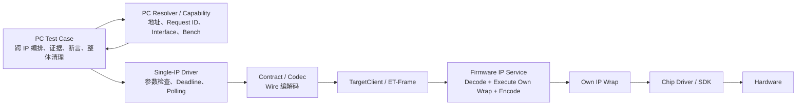

# ET 自动化测试平台重构主实施计划

文档状态：最终软件执行基线 v2.4  
制定日期：2026-08-06  
最终软件复核：2026-08-07  
目标仓库：`Abba-shenfu/Automated_Testing_Platform`  
目标分支：`review_code`  
软件闭环代码基线：`f7b8aba354f094cda793df4c4f343781690214fd`

> 本文是本轮重构的主状态与完成判定基线。Phase 0～5 以及 Phase 6 的**非硬件软件子范围**已经完成；实际 ET6801 FPGA/Silicon Keil Build 与真实 HIL 按用户要求暂不执行，独立保持 `NOT_EXECUTED`。历史技术推演与细化步骤继续参考 [PC 控制面与 Firmware 执行面重构实施计划](20260806_pc_firmware_trust_boundary_refactor_plan.md)，但当前实现状态、软件完成证据和退出结论以本文及 [软件层最终重构 Review](../review/20260807_software_layer_final_review.md) 为准。

关联强制规则：

- `AGENTS.md`
- `report/design/firmware_service_execution_contract.md`
- `report/design/pc_code_design_rules.md`
- `report/design/pc_python_code_style_and_quality_gate.md`
- `report/design/pc_ip_package_template.md`
- `report/design/pc_firmware_architecture_review_checklist.md`
- `report/review/20260807_software_layer_final_review.md`
- `report/final/20260806_refactor_final_report.md`

---

## 1. 最终目标与当前完成范围

本轮重构目标：

1. **职责边界正确**：PC 是可信控制面，Firmware 是命令执行面；
2. **执行映射集中**：Address、Request ID、Controller、Interface 和 Bench 事实由 PC Resolver 统一解析；
3. **Firmware 去跨 IP 化**：Service 只解码、调用本 IP Wrap、返回事实；
4. **可靠性闭环**：Deadline、Retry、Cleanup、Cache、IRQ Manager、Frame Parser 均可测、可恢复；
5. **PC 代码可审核**：Driver、Codec、Model、Validation、Resolver、Case 分层明确；
6. **Formal Test Case 可信**：主要测试主体、步骤、证据、断言和清理直接可读；
7. **永久质量门禁**：Ruff、AST、Formal Case Rule、Unit、Contract、Native、Formal Collect 持续执行；
8. **结论真实**：软件验证、实际 Keil Build、真实 HIL 分开记录，未执行绝不写成 PASS。

当前判定：

```text
非硬件软件层目标                     DONE
实际 ET6801 FPGA Keil Build           NOT_EXECUTED
实际 ET6801 Silicon Keil Build        NOT_EXECUTED
真实 FPGA/Silicon HIL                 NOT_EXECUTED
```

因此可以宣布“**软件层重构完成**”，但不能宣布“完整硬件交付完成”。

---

## 2. 最终架构



Firmware Service 固定公式：

```text
Service = Decode + Execute Own Wrap + Encode Facts
```

### 2.1 信任边界

- Test Case 是跨 IP 顺序、Evidence、最终 Assertion 和整体 Cleanup 的唯一所有者；
- Driver 只负责一个 IP，禁止调用其他 IP Driver；
- Codec 只负责 Wire，禁止访问 TargetClient、Capability、Bench；
- Resolver 只解析静态/运行时事实，禁止发送硬件命令；
- Firmware Service 只能调用本 IP Wrap；
- Wrap 只能调用本 IP Chip Driver / SDK；
- Firmware 不重复判断 PC 已完成的跨 IP 业务正确性。

### 2.2 Wire

- Published Command ID 不得静默改义；
- 新语义必须使用新 Command ID；
- SYSCTRL DMA Mux V2 使用新 Command；
- DMA LLI Direct Address V2 使用新 Command；
- 旧命令保留兼容编号时必须明确 Deprecated/Reserved/NOT_SUPPORTED；
- Formal Case 不得继续调用旧 V1 执行路径。

---

## 3. 最终状态板

| 阶段 | 内容 | 状态 | 最终证据 |
|---|---|---|---|
| Phase 0 | 基线、Golden Vector、缺陷锁定 | DONE | Phase 0～2 Review |
| Phase 1 | PC 质量门禁基础 | DONE | Run `31080015924` |
| Phase 2 | Deadline、Cleanup、TargetClient、Framework Cache | DONE | Phase 0～2 Review |
| Phase 3 | DMA PC Package | DONE | Run `31082335860` |
| Phase 4 | Execution Mapping、SYSCTRL V2、DMA Firmware 执行代理化 | DONE | Phase 4 Review |
| Phase 5 | Reliability 与 PC/Firmware Package 全面收敛 | DONE | Phase 5 Review |
| Phase 6A | Formal Case 按 Feature/主要主体重构 | DONE | Software Final Review |
| Phase 6B | Software Static / Unit / Contract / Native | DONE | `331 passed, 3 skipped` |
| Phase 6E | Software Final Review / Permanent CI / Migration Cleanup | DONE | Run `31137876718` + Permanent Run `31138292203` |
| **软件层整体重构** | **PC + Firmware + Formal Case + CI** | **DONE** | `f7b8aba...` + Permanent Gate |
| Phase 6C | 实际 Keil FPGA/Silicon Build | NOT_EXECUTED | Build Report |
| Phase 6D | 真实 HIL | NOT_EXECUTED | HIL Report |

---

## 4. Phase 4 最终闭环

### 4.1 ET6801 UART DMA Mapping

已由 PC Mapping/Resolver 固化并交叉核对：

| UART | 方向 | 外设地址 | Request ID |
|---|---:|---:|---:|
| UART0 | TX | `0x40500000` | `192` |
| UART0 | RX | `0x40500000` | `193` |
| UART1 | TX | `0x40501000` | `194` |
| UART1 | RX | `0x40501000` | `195` |
| UART2 | TX | `0x40502000` | `196` |
| UART2 | RX | `0x40502000` | `197` |

Resolver 核对 Chip、Capability Address、Runtime Services、Bench Provider、DMA Controller、Interface 和 Request ID，不发送命令。

### 4.2 SYSCTRL V2

正式执行链：

```text
PC Resolver
-> SysctrlDriver.configure_route()
-> SYSCTRL V2 Wire
-> SYSCTRL Firmware Service
-> SYSCTRL Wrap
```

Formal Case 不再通过 UART Endpoint Registry / Resource Registry / SYSCTRL V1 完成 DMA Mux。

### 4.3 DMA LLI V2

Formal LLI Case 使用 Descriptor Address V2，不再依赖旧 Resource Handle -> Firmware Resolve 地址路径。

---

## 5. Phase 5 最终可靠性闭环

已完成并保留永久回归：

- Request Write / Read / Retry 共享 Operation Deadline；
- Decoder 同批 Response 后 Event 不丢失；
- Duplicate Response Fail Closed；
- DMA/UART 长操作总 Deadline；
- Primary Error 与所有 Cleanup Error 同时保留；
- Session Cache 不跨新会话泄漏；
- UART Wrap Deinit 失败不提前丢真实 Handle；
- IRQ Bind Rollback Failure 保留 Cleanup Ownership；
- DMA ISR 状态读取失败可观测；
- UART Capture 内部 Cleanup Fault 不被数据匹配掩盖；
- Control UART Close、Resource Create、Service Registry 支持失败恢复/回滚；
- Frame Parser 无新字节时继续 Drain 缓存完整 Frame。

历史 Ruff Allowlist：`0`。

---

## 6. Phase 6A：Formal Test Case 最终规则

### 6.1 目录归属

DMA：

```text
test_cases/dma/
├── test_memory_to_memory.py
├── test_channel_control.py
├── test_interrupts.py
├── test_linked_list.py
├── test_gather_scatter.py
├── test_handshake.py
├── test_register_snapshots.py
└── deferred_features.py
```

UART：

```text
test_cases/uart/
├── test_polling.py
├── test_interrupts.py
├── test_dma_tx.py
├── test_dma_rx.py
├── test_dma_full_duplex.py
└── deferred_features.py
```

UART DMA TX/RX/Full Duplex 归 UART 主体；参与多个 IP 不等于必须放入 Integration。

### 6.2 Formal Case 必须直接展示

```text
Arrange -> Resolve -> Configure -> Start -> Observe -> Assert -> Cleanup
```

每个 Formal Case 必须说明：

- 测试 Feature；
- 主要测试主体；
- 参与/支撑 IP；
- 前置条件；
- 测试步骤；
- 观测证据；
- 通过条件；
- 清理要求。

### 6.3 Helper 边界

Helper 只允许：

- 纯数据生成；
- 单一有界等待；
- Evidence 转换；
- 通用 Cleanup 聚合基础设施。

禁止：

- Helper 运行完整 Case；
- Helper 拥有最终 Assertion/Conclusion；
- Helper 隐藏多个生命周期阶段；
- Helper 持有整体 Cleanup；
- 非 Test Helper Module 同时编排多个 IP Driver；
- raw `finally` 顺序 Cleanup；
- Blocked/Observability 未批准 Feature 伪装成 Formal `test_*`。

永久执行规则工具：

```text
tools/check_case_orchestration_rules.py
```

### 6.4 已清零旧路径

最终生产树扫描并永久禁止：

```text
execute_m2m_transfer
execute_peripheral_transfer
execute_dma_transfer_done_interrupt
_cleanup_all
build_dma_peripheral_pair
Formal Case configure_dma_request( V1
uart_session
loopback_transfer
paired_transfer
_require_irq_event
require_cleanup
```

`dma_peer.py` 已删除。

---

## 7. Error / Cleanup / Result 规则

Formal Case 使用：

```text
case_cleanup_scope(cleanup_actions)
```

Cleanup 必须尽量执行所有已注册动作，并保留：

```text
Primary Error + Cleanup Errors
```

Measurement JSON 只保存 Measurement/Evidence；pytest Assertion 与统一 Result 拥有最终 PASS/FAIL。

Blocked Feature 必须进入 `deferred_features.py`，不能作为正式 Skip Case 制造覆盖假象。

---

## 8. Protocol Capacity

UART 软件传输能力已与 ET-Frame / ET-Message 的真实 Body Capacity 对齐：

- PC Driver 长读写按安全容量分块；
- Firmware Service 长度 Fail Closed；
- Runtime Capability 不再承诺单次超出协议容量的 Body；
- Protocol Capacity 有 Unit Contract 防回退。

---

## 9. 最终软件验证

### 9.1 收口验证

Run：`31137876718`。

候选树先执行完整验证；删除所有临时迁移资产后，再对最终生产树重复一次完整验证。

```text
Python Syntax                         PASS
Ruff Format                           PASS
Ruff Lint                             PASS
PC AST Architecture Rules             PASS
Formal Case Orchestration Rules       PASS
Generated Firmware Project Contract   PASS
PC Unit / Contract / Native            331 passed, 3 skipped
Formal Case Collection                235 nodes
Legacy Formal Case Path Scan          PASS / 0 hit
Temporary Refactor Asset Check        PASS
Git diff --check                      PASS
```

3 个 Skip 是环境门禁，不代表任何硬件 PASS。

235 个节点只证明 Formal Case 的软件定义、Import、Fixture、参数化和 Collection 完整，不表示硬件执行通过。

### 9.2 永久门禁复验

最终文档 HEAD：`ecf07435288dc5e945410d3575aaf3b053212861`。

永久 `Software Quality Gate` Run：`31138292203`。

在**最终生产树、无 `tools/refactor/`、无 one-shot Workflow** 的状态下再次通过：

```text
Python / Ruff / AST                   PASS
Formal Case Orchestration             PASS
Generated Firmware Project Contract   PASS
Unit / Contract / Native               331 passed, 3 skipped
Formal Case Collection                235 nodes
Working Tree Clean                    PASS
```

---

## 10. 永久 CI

最终 `.github/workflows/` 只保留：

```text
pc-quality.yml
```

Workflow 名称：`Software Quality Gate`。

覆盖：

```text
pc/**
firmware/**
tools/**
pyproject.toml
.github/workflows/**
```

统一入口：

```text
python tools/validate_pc.py
```

永久检查：

```text
Python Syntax
Ruff Format / Lint
PC AST Architecture Rules
Formal Case Orchestration Rules
Generated Firmware Project Contract
PC Unit / Contract / Native
Formal Case Collection
Working Tree Clean
```

Generated Firmware Project Contract 只验证工程描述/生成合同，不等价于实际 Keil Build。

---

## 11. 临时迁移资产

最终软件闭环提交：

```text
f7b8aba354f094cda793df4c4f343781690214fd
refactor: complete software-layer architecture closure
```

删除：

- `tools/refactor/` 全目录；
- 所有 `.github/workflows/one-shot-*.yml`；
- `.github/workflows/case-orchestration-audit.yml`；
- `test_cases/dma/dma_peer.py`；
- 对应旧 Adapter/Helper Unit Contract。

当前迁移债务：`0`。

---

## 12. 硬件验证边界

本轮按用户要求不继续硬件链路，因此：

```text
ET6801 FPGA Keil Build       NOT_EXECUTED
ET6801 Silicon Keil Build    NOT_EXECUTED
真实 FPGA/Silicon HIL        NOT_EXECUTED
```

未执行项目不得写成 PASS。

未来若要宣布“完整 FPGA/Silicon 硬件交付完成”，必须实际执行 Build、记录 Build ID、连接真实 Bench 并完成 HIL。

---

## 13. 最终完成条件与判定

### 软件层完成条件

以下已经全部满足：

- PC/Firmware 信任边界满足最终设计；
- Resolver/Mapping 唯一主线；
- Formal Case 不依赖旧 V1/跨 IP Adapter；
- Formal Case 编排规则 0 violation；
- Ruff / AST 0 violation；
- Unit / Contract / Native 全绿（环境 Skip 单独记录）；
- Formal Case 全量 Collection 成功；
- 临时迁移资产清零；
- 永久 CI 在最终生产树再次成功。

结论：

```text
Software Architecture Review : PASS
Software Reliability Review  : PASS
Formal Case Software Review   : PASS
Permanent Software Gate       : PASS
Software Refactor             : DONE
```

### 完整硬件交付条件

仍待未来执行：

- ET6801 FPGA 实际 Keil Build；
- ET6801 Silicon 实际 Keil Build；
- PC/Firmware Build ID 匹配；
- 真实 Framework/Resource/DMA/UART/UART-DMA/Cleanup HIL。

结论：

```text
Hardware Build / HIL : NOT_EXECUTED
```

---

## 14. 计划变更记录

| 版本 | 日期 | 变更 | 原因 |
|---|---|---|---|
| v2.4 | 2026-08-07 | 软件层最终标记 DONE；记录 `331 passed, 3 skipped`、235 Formal nodes、永久 Gate 和迁移债务 0；硬件独立 NOT_EXECUTED | 用户要求先完成所有非硬件软件层，并严格按规则验收 |
| v2.3 | 2026-08-06 | Phase 6 Host 初步重构完成，硬件环境阻断 | 第一轮 Phase 6 |
| v2.2 | 2026-08-06 | Phase 5 完成 | Reliability/Package 收敛 |
| v2.1 | 2026-08-06 | Phase 4 完成 | Mapping/SYSCTRL V2/DMA 执行代理化 |
| v2.0 | 2026-08-06 | 剩余工作压缩为三个大阶段 | 提高推进效率 |
| v1.3 | 2026-08-06 | Phase 3 DMA Package 完成 | 行为保持型拆分 |
| v1.2 | 2026-08-06 | Phase 0～2 完成 | 第一批实施 |
| v1.1 | 2026-08-06 | Case 改为按主要测试主体归属 | UART DMA 归属规则确认 |
| v1.0 | 2026-08-06 | 建立正式主实施计划 | 固定架构、顺序与阻断点 |
